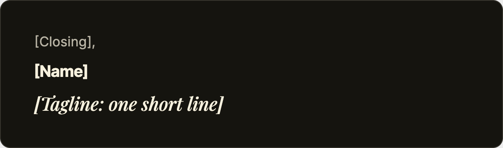

<!-- Generated by .claude/skills/shopify-email-html/scripts/build_library.py — edit section.json / template.json instead. -->

# Utility · Sign-off · Ink

| | |
|---|---|
| Type | Sign-off |
| Context | any |
| Surfaces | Messaging · Code your own, Messaging section |
| Liquid variables | — |
| Shopify status | unused |
| Placeholders | yes — do not ship as is |
| Characters | 1178 |
| Used by | — |

> Module bank. All copy is a labelled slot: replace it before use.

## Module bank

- Category: 08 · Utility
- Module: Utility · Sign-off · theme **ink**
- Figma source: [Regard / sign-off](https://www.figma.com/design/9Il504CQE8jLaUTBVzphqc/Email-Design-System?node-id=479-17073)

**Changed from the Figma module to meet the v6 rules**

- Closing in the v6 body role, name in the v6 subtitle role, tagline in the v6 note role (serif italic)
- Never a handwritten-signature image

**Figma sample copy (reference only, not in the section)**: Warmly, · Hair Solutions Co. · A new look should still feel unmistakably like you.

## Preview



## HTML

Source: [`section.html`](section.html). Copy from here or from the raw file.

```html
<table role="presentation" width="100%" cellpadding="0" cellspacing="0" border="0" style="background-color:transparent;"><tr><td align="center" style="padding:0;">
<table role="presentation" class="shell" width="100%" cellpadding="0" cellspacing="0" border="0" style="width:100%;max-width:600px;">
<tr><td style="padding:0;">
<table role="presentation" width="100%" cellpadding="0" cellspacing="0" border="0" style="border-collapse:separate;background-color:#15140f;border:1px solid #35332c;border-radius:12px;">
<tr><td class="pad" style="padding:36px 40px;"><p style="margin:0 0 10px 0;font-family:'Inter',Arial,Helvetica,sans-serif;font-size:16px;line-height:26px;font-weight:400;color:#b8b3a4;text-align:left;">[Closing],</p><h3 style="margin:0 0 10px 0;font-family:'Inter Tight',Arial,Helvetica,sans-serif;font-size:19px;line-height:24px;font-weight:700;color:#f7f1de;text-align:left;">[Name]</h3><p style="margin:0 0 0px 0;font-family:'Playfair Display',Georgia,'Times New Roman',serif;font-size:22px;line-height:33px;font-weight:500;color:#f7f1de;text-align:left;font-style:italic;">[Tagline: one short line]</p></td></tr>
</table>
</td></tr>
</table>
</td></tr></table>
```
