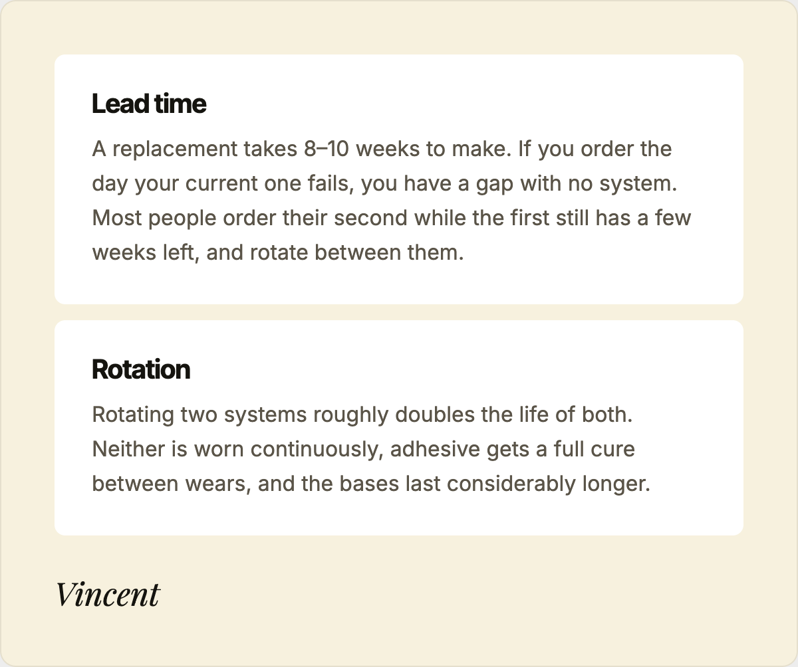

<!-- Generated by .claude/skills/shopify-email-html/scripts/build_library.py — edit section.json / template.json instead. -->

# RO-3 · Lead time and rotation

| | |
|---|---|
| Type | Text |
| Context | any |
| Surfaces | Messaging · Code your own, Messaging section |
| Liquid variables | — |
| Shopify status | draft |
| Placeholders | no |
| Characters | 2788 |
| Used by | [RO-3](../../emails/ro-3-replacement-window/) |

> Lead time confirmed by Vincent on 2026-10-04: custom hair systems take 8-10 weeks, stock systems 5-7 days. A replacement is a custom system, so the email says 8-10 weeks (the Figma placeholder was '[Production lead time]').

## Preview



## HTML

Source: [`section.html`](section.html). Copy from here or from the raw file.

```html
<table role="presentation" width="100%" cellpadding="0" cellspacing="0" border="0" style="background-color:transparent;"><tr><td align="center" style="padding:0;">
<table role="presentation" class="shell" width="100%" cellpadding="0" cellspacing="0" border="0" style="width:100%;max-width:600px;">
<tr><td style="padding:0;">
<table role="presentation" width="100%" cellpadding="0" cellspacing="0" border="0" style="border-collapse:separate;background-color:#f7f1de;border:1px solid #e5dfcd;border-radius:12px;">
<tr><td class="pad" style="padding:40px;"><table role="presentation" width="100%" cellpadding="0" cellspacing="0" border="0" style="border-collapse:separate;margin:0 0 12px 0;"><tr><td style="padding:0;"><table role="presentation" width="100%" cellpadding="0" cellspacing="0" border="0" style="border-collapse:separate;background-color:#ffffff;border-radius:8px;"><tr><td class="pad-q" style="padding:24px 28px 26px 28px;"><p style="margin:0 0 8px 0;font-family:'Inter Tight',Arial,Helvetica,sans-serif;font-size:20px;line-height:26px;font-weight:700;letter-spacing:-0.4px;color:#15140f;text-align:left;">Lead time</p><p style="margin:0;font-family:'Inter',Arial,Helvetica,sans-serif;font-size:16px;line-height:26px;font-weight:400;color:#5a5448;text-align:left;">A replacement takes 8&ndash;10 weeks to make. If you order the day your current one fails, you have a gap with no system. Most people order their second while the first still has a few weeks left, and rotate between them.</p></td></tr></table></td></tr></table><table role="presentation" width="100%" cellpadding="0" cellspacing="0" border="0" style="border-collapse:separate;margin:0 0 0px 0;"><tr><td style="padding:0;"><table role="presentation" width="100%" cellpadding="0" cellspacing="0" border="0" style="border-collapse:separate;background-color:#ffffff;border-radius:8px;"><tr><td class="pad-q" style="padding:24px 28px 26px 28px;"><p style="margin:0 0 8px 0;font-family:'Inter Tight',Arial,Helvetica,sans-serif;font-size:20px;line-height:26px;font-weight:700;letter-spacing:-0.4px;color:#15140f;text-align:left;">Rotation</p><p style="margin:0;font-family:'Inter',Arial,Helvetica,sans-serif;font-size:16px;line-height:26px;font-weight:400;color:#5a5448;text-align:left;">Rotating two systems roughly doubles the life of both. Neither is worn continuously, adhesive gets a full cure between wears, and the bases last considerably longer.</p></td></tr></table></td></tr></table><div style="height:28px;line-height:28px;font-size:0;">&nbsp;</div><p style="margin:0 0 0px 0;font-family:'Playfair Display',Georgia,'Times New Roman',serif;font-size:24px;line-height:30px;font-weight:400;color:#15140f;text-align:left;font-style:italic;">Vincent</p></td></tr>
</table>
</td></tr>
</table>
</td></tr></table>
```
