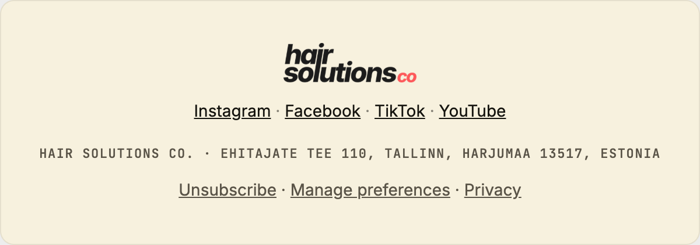

<!-- Generated by .claude/skills/shopify-email-html/scripts/build_library.py — edit section.json / template.json instead. -->

# v6 · Footer (paper, social links)

| | |
|---|---|
| Type | Preferences footer |
| Context | any |
| Surfaces | Messaging · Code your own, Messaging section |
| Liquid variables | `unsubscribe_url`, `unsubscribe_link` |
| Shopify status | draft |
| Placeholders | no |
| Characters | 2592 |
| Used by | [NL-01](../../emails/nl-01-no-best-base/), [W-1](../../emails/w-1-welcome/) |

> Cream footer: logo, the four social channels as text links, address, Unsubscribe · Manage preferences · Privacy. The visible Unsubscribe uses {{ unsubscribe_url }} (the shared head forces pale grey on {{ unsubscribe_link }}); {{ unsubscribe_link }} is also present inside an HTML comment because Code your own requires the tag (verify Shopify accepts it before activation).

## Preview



## HTML

Source: [`section.html`](section.html). Copy from here or from the raw file.

```html
<table role="presentation" width="100%" cellpadding="0" cellspacing="0" border="0" style="background-color:transparent;"><tr><td align="center" style="padding:0;">
<table role="presentation" class="shell" width="100%" cellpadding="0" cellspacing="0" border="0" style="width:100%;max-width:600px;">
<tr><td style="padding:0;">
<table role="presentation" width="100%" cellpadding="0" cellspacing="0" border="0" style="border-collapse:separate;background-color:#f7f1de;border:1px solid #e5dfcd;border-radius:12px;">
<tr><td class="pad-sm" style="padding:36px 24px 36px 24px;"><p style="margin:0 0 18px 0;font-family:'Inter',Arial,Helvetica,sans-serif;font-size:14px;line-height:21px;font-weight:400;color:#15140f;text-align:center;"><a href="https://www.instagram.com/hairsolutions_co" target="_blank" style="color:#15140f;text-decoration:underline;">Instagram</a> <span style="color:#15140f;opacity:0.5;">&middot;</span> <a href="https://www.facebook.com/hairsolutions.company" target="_blank" style="color:#15140f;text-decoration:underline;">Facebook</a> <span style="color:#15140f;opacity:0.5;">&middot;</span> <a href="https://www.tiktok.com/@hairsolutionsco" target="_blank" style="color:#15140f;text-decoration:underline;">TikTok</a> <span style="color:#15140f;opacity:0.5;">&middot;</span> <a href="https://www.youtube.com/@hairsolutions_co" target="_blank" style="color:#15140f;text-decoration:underline;">YouTube</a></p><p style="margin:0 0 12px 0;font-family:'JetBrains Mono','Courier New',monospace;font-size:11px;line-height:17px;font-weight:500;letter-spacing:0.8px;text-transform:uppercase;color:#5a5448;text-align:center;">Hair Solutions Co. &middot; Ehitajate tee 110, Tallinn, Harjumaa 13517, Estonia</p><p style="margin:0;font-family:'Inter',Arial,Helvetica,sans-serif;font-size:14px;line-height:21px;font-weight:400;color:#5a5448;text-align:center;"><a href="{{ unsubscribe_url }}" target="_blank" style="color:#5a5448;text-decoration:underline;">Unsubscribe</a> &middot; <a href="https://hairsolutions.co/pages/edit-notifications" target="_blank" style="color:#5a5448;text-decoration:underline;">Manage preferences</a> &middot; <a href="https://hairsolutions.co/policies/privacy-policy" target="_blank" style="color:#5a5448;text-decoration:underline;">Privacy</a></p><!-- {{ unsubscribe_link }} --></td></tr>
</table>
</td></tr>
</table>
</td></tr></table>
```
