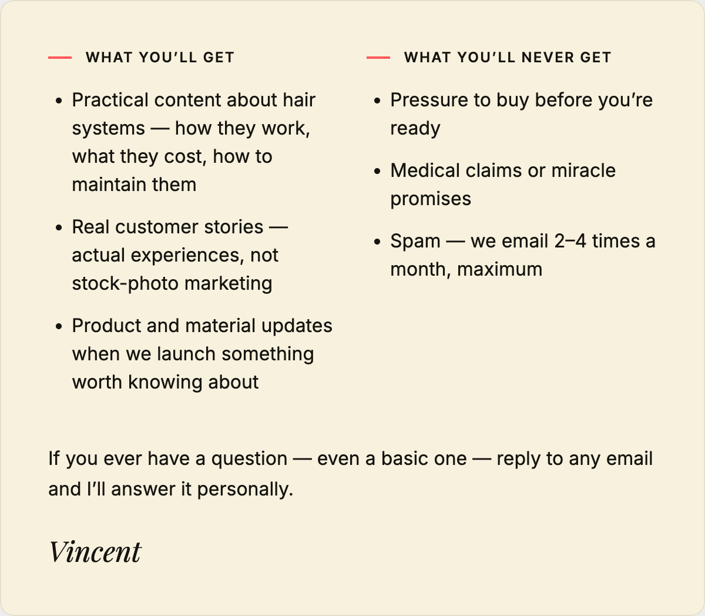

<!-- Generated by .claude/skills/shopify-email-html/scripts/build_library.py — edit section.json / template.json instead. -->

# W-1 · What you'll get / never get

| | |
|---|---|
| Type | Checklist |
| Context | any |
| Surfaces | Messaging · Code your own, Messaging section |
| Liquid variables | — |
| Shopify status | draft |
| Placeholders | no |
| Characters | 3982 |
| Used by | [W-1](../../emails/w-1-welcome/) |

## Preview



## HTML

Source: [`section.html`](section.html). Copy from here or from the raw file.

```html
<table role="presentation" width="100%" cellpadding="0" cellspacing="0" border="0" style="background-color:transparent;"><tr><td align="center" style="padding:0;">
<table role="presentation" class="shell" width="100%" cellpadding="0" cellspacing="0" border="0" style="width:100%;max-width:600px;">
<tr><td style="padding:0;">
<table role="presentation" width="100%" cellpadding="0" cellspacing="0" border="0" style="border-collapse:separate;background-color:#f7f1de;border:1px solid #e5dfcd;border-radius:12px;">
<tr><td class="pad" style="padding:40px;"><table role="presentation" width="100%" cellpadding="0" cellspacing="0" border="0"><tr><td class="stack" width="50%" valign="top" style="width:50%;vertical-align:top;padding:0 12px 0 0px;"><table role="presentation" width="100%" cellpadding="0" cellspacing="0" border="0"><tr><td style="padding:0;"><table role="presentation" cellpadding="0" cellspacing="0" border="0" style="margin:0 0 16px 0;">
<tr><td width="20" style="width:20px;vertical-align:middle;"><div style="height:2px;line-height:2px;font-size:0;background-color:#ff5757;">&nbsp;</div></td>
<td style="padding-left:12px;font-family:'Inter Tight',Arial,Helvetica,sans-serif;font-size:12px;line-height:16px;font-weight:600;letter-spacing:1.6px;text-transform:uppercase;color:#15140f;white-space:nowrap;">What you&rsquo;ll get</td></tr>
</table><ul style="margin:0;padding:0 0 0 20px;"><li style="margin:0 0 12px 0;font-family:'Inter',Arial,Helvetica,sans-serif;font-size:16px;line-height:24px;color:#15140f;">Practical content about hair systems &mdash; how they work, what they cost, how to maintain them</li><li style="margin:0 0 12px 0;font-family:'Inter',Arial,Helvetica,sans-serif;font-size:16px;line-height:24px;color:#15140f;">Real customer stories &mdash; actual experiences, not stock-photo marketing</li><li style="margin:0 0 12px 0;font-family:'Inter',Arial,Helvetica,sans-serif;font-size:16px;line-height:24px;color:#15140f;">Product and material updates when we launch something worth knowing about</li></ul></td></tr></table></td><td class="stack" width="50%" valign="top" style="width:50%;vertical-align:top;padding:0 0px 0 12px;"><table role="presentation" width="100%" cellpadding="0" cellspacing="0" border="0"><tr><td style="padding:0;"><table role="presentation" cellpadding="0" cellspacing="0" border="0" style="margin:0 0 16px 0;">
<tr><td width="20" style="width:20px;vertical-align:middle;"><div style="height:2px;line-height:2px;font-size:0;background-color:#ff5757;">&nbsp;</div></td>
<td style="padding-left:12px;font-family:'Inter Tight',Arial,Helvetica,sans-serif;font-size:12px;line-height:16px;font-weight:600;letter-spacing:1.6px;text-transform:uppercase;color:#15140f;white-space:nowrap;">What you&rsquo;ll never get</td></tr>
</table><ul style="margin:0;padding:0 0 0 20px;"><li style="margin:0 0 12px 0;font-family:'Inter',Arial,Helvetica,sans-serif;font-size:16px;line-height:24px;color:#15140f;">Pressure to buy before you&rsquo;re ready</li><li style="margin:0 0 12px 0;font-family:'Inter',Arial,Helvetica,sans-serif;font-size:16px;line-height:24px;color:#15140f;">Medical claims or miracle promises</li><li style="margin:0 0 12px 0;font-family:'Inter',Arial,Helvetica,sans-serif;font-size:16px;line-height:24px;color:#15140f;">Spam &mdash; we email 2&ndash;4 times a month, maximum</li></ul></td></tr></table></td></tr></table><div style="height:28px;line-height:28px;font-size:0;">&nbsp;</div><p style="margin:0 0 24px 0;font-family:'Inter',Arial,Helvetica,sans-serif;font-size:16px;line-height:26px;font-weight:400;color:#15140f;text-align:left;">If you ever have a question &mdash; even a basic one &mdash; reply to any email and I&rsquo;ll answer it personally.</p><p style="margin:0 0 0px 0;font-family:'Playfair Display',Georgia,'Times New Roman',serif;font-size:24px;line-height:30px;font-weight:400;color:#15140f;text-align:left;font-style:italic;">Vincent</p></td></tr>
</table>
</td></tr>
</table>
</td></tr></table>
```
