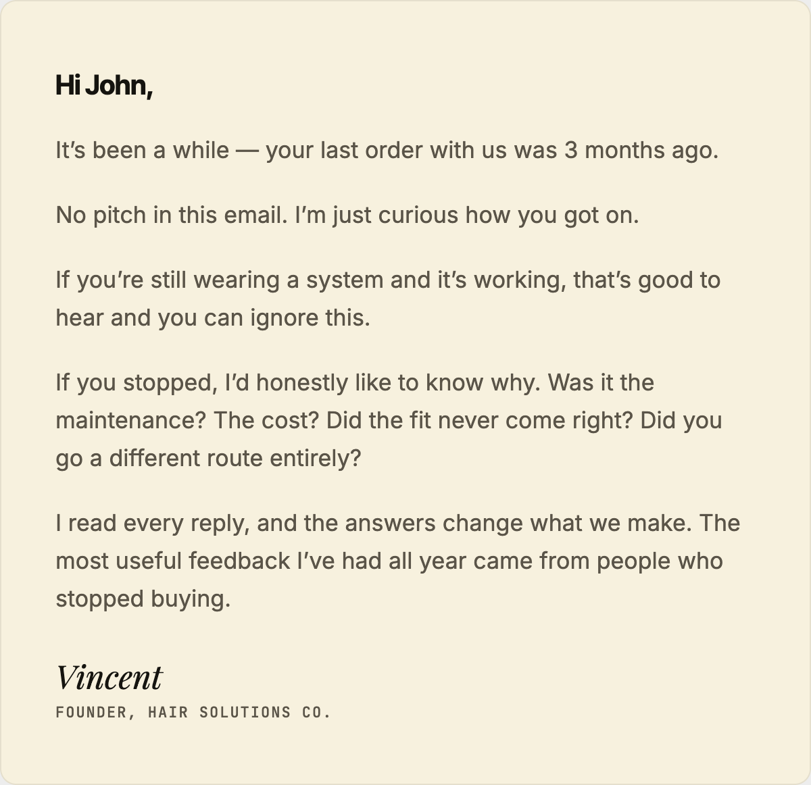

<!-- Generated by .claude/skills/shopify-email-html/scripts/build_library.py — edit section.json / template.json instead. -->

# WB-1 · Founder letter

| | |
|---|---|
| Type | Text |
| Context | customer |
| Surfaces | Messaging · Code your own, Messaging section |
| Liquid variables | `customer.first_name`, `customer.last_order.created_at` |
| Shopify status | draft |
| Placeholders | no |
| Characters | 2856 |
| Used by | [WB-1](../../emails/wb-1-checking-in/) |

> Plain-text founder letter, reply-only by design (no button, no offer). Copy from the older Figma frame 'WB-1 · Checking In'; the sign-off 'Vincent / Founder, Hair Solutions Co.' is from the Notion emails master because the frame omits it. {{ months_since_last_order }} is computed from customer.last_order.created_at (30-day months).

## Preview



## HTML

Source: [`section.html`](section.html). Copy from here or from the raw file.

```html
<table role="presentation" width="100%" cellpadding="0" cellspacing="0" border="0" style="background-color:transparent;"><tr><td align="center" style="padding:0;">
<table role="presentation" class="shell" width="100%" cellpadding="0" cellspacing="0" border="0" style="width:100%;max-width:600px;">
<tr><td style="padding:0;">
<table role="presentation" width="100%" cellpadding="0" cellspacing="0" border="0" style="border-collapse:separate;background-color:#f7f1de;border:1px solid #e5dfcd;border-radius:12px;">
<tr><td class="pad" style="padding:48px 40px 44px 40px;">{%- assign last_s = customer.last_order.created_at | date: "%s" | plus: 0 -%}{%- assign now_s = "now" | date: "%s" | plus: 0 -%}<p style="margin:0 0 20px 0;font-family:'Inter Tight',Arial,Helvetica,sans-serif;font-size:20px;line-height:28px;font-weight:700;letter-spacing:-0.3px;color:#15140f;text-align:left;">Hi {{ customer.first_name | default: "there" }},</p><p style="margin:0 0 20px 0;font-family:'Inter',Arial,Helvetica,sans-serif;font-size:17px;line-height:28px;font-weight:400;color:#5a5448;text-align:left;">It&rsquo;s been a while &mdash; your last order with us was {{ months_since }} months ago.</p><p style="margin:0 0 20px 0;font-family:'Inter',Arial,Helvetica,sans-serif;font-size:17px;line-height:28px;font-weight:400;color:#5a5448;text-align:left;">No pitch in this email. I&rsquo;m just curious how you got on.</p><p style="margin:0 0 20px 0;font-family:'Inter',Arial,Helvetica,sans-serif;font-size:17px;line-height:28px;font-weight:400;color:#5a5448;text-align:left;">If you&rsquo;re still wearing a system and it&rsquo;s working, that&rsquo;s good to hear and you can ignore this.</p><p style="margin:0 0 20px 0;font-family:'Inter',Arial,Helvetica,sans-serif;font-size:17px;line-height:28px;font-weight:400;color:#5a5448;text-align:left;">If you stopped, I&rsquo;d honestly like to know why. Was it the maintenance? The cost? Did the fit never come right? Did you go a different route entirely?</p><p style="margin:0 0 28px 0;font-family:'Inter',Arial,Helvetica,sans-serif;font-size:17px;line-height:28px;font-weight:400;color:#5a5448;text-align:left;">I read every reply, and the answers change what we make. The most useful feedback I&rsquo;ve had all year came from people who stopped buying.</p><p style="margin:0 0 4px 0;font-family:'Playfair Display',Georgia,'Times New Roman',serif;font-size:24px;line-height:30px;font-weight:400;color:#15140f;text-align:left;font-style:italic;">Vincent</p><p style="margin:0 0 0px 0;font-family:'JetBrains Mono','Courier New',monospace;font-size:11px;line-height:17px;font-weight:500;letter-spacing:1px;text-transform:uppercase;color:#5a5448;text-align:left;">Founder, Hair Solutions Co.</p></td></tr>
</table>
</td></tr>
</table>
</td></tr></table>
```
