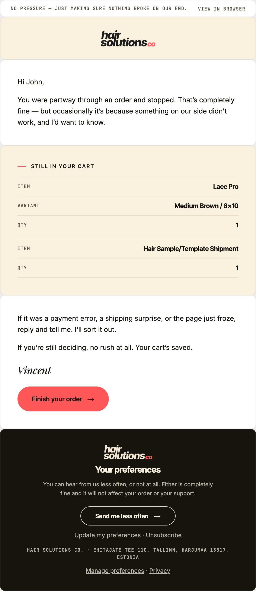

<!-- Generated by .claude/skills/shopify-email-html/scripts/build_library.py — edit section.json / template.json instead. -->

# CR-1 · Your cart's still here

| | |
|---|---|
| Code | CR-1 |
| Journey | cart-recovery |
| Surface | Messaging · Custom Liquid sections |
| Where in Shopify | Flow › Recover abandoned checkout › Send marketing email #1 (Messaging, Custom Liquid sections) |
| Subject | `Your cart's still here` |
| Preview text | No pressure — just making sure nothing broke on our end. |
| Timing | Abandon + 4 h |
| Shopify status | draft |
| Shopify matches this repo | yes |

## Sections (assembly order)

1. [Email head (fonts + styles)](../../email-blocks/00-email-head-fonts-styles/) — `00-email-head-fonts-styles`
2. [CR-1 · Preheader bar](../../email-blocks/01-cr-1-preheader-bar/) — `01-cr-1-preheader-bar`
3. [Logo header](../../email-blocks/02-logo-header/) — `02-logo-header`
4. [CR-1 · Greeting](../../email-blocks/03-cr-1-greeting/) — `03-cr-1-greeting`
5. [Cart contents](../../email-blocks/04-cart-contents/) — `04-cart-contents`
6. [CR-1 · Sign-off + CTA](../../email-blocks/05-cr-1-sign-off-cta/) — `05-cr-1-sign-off-cta`
7. [Preferences footer](../../email-blocks/06-preferences-footer/) — `06-preferences-footer`

## Code to install

One Shopify Messaging **Custom Liquid** section per file, in this order:

- [`custom-liquid/01.html`](custom-liquid/01.html)
- [`custom-liquid/02.html`](custom-liquid/02.html)
- [`custom-liquid/03.html`](custom-liquid/03.html)
- [`custom-liquid/04.html`](custom-liquid/04.html)
- [`custom-liquid/05.html`](custom-liquid/05.html)
- [`custom-liquid/06.html`](custom-liquid/06.html)

## Open blockers

- Workflow inactive and email in draft.
- Shopify adds its own legal footer under sectioned emails.

## Preview

## Rebuild

Edit `template.json` (`sections` is the recipe) or a section, then run `python3 .claude/skills/shopify-email-html/scripts/build_library.py` from the repo root.
