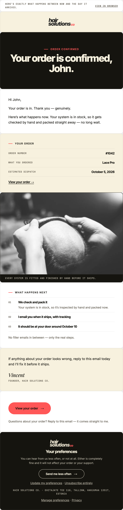

<!-- Generated by .claude/skills/shopify-email-html/scripts/build_library.py — edit section.json / template.json instead. -->

# PP-1 · Order confirmation

| | |
|---|---|
| Code | PP-1 |
| Journey | post-purchase |
| Surface | Notification template |
| Where in Shopify | Settings › Notifications › Customer notifications › Order confirmation |
| Subject | `Your order is confirmed, {{ customer.first_name }}.` |
| Preview text | Here's exactly what happens between now and the day it arrives. |
| Timing | Sent when an order is placed |
| Shopify status | live |
| Shopify matches this repo | yes |

## Sections (assembly order)

1. [PP-1 Liquid header (order variables + lead times)](../../email-blocks/24-pp-1-liquid-header-order-variables-lead-times/) — `24-pp-1-liquid-header-order-variables-lead-times`
2. [Email head (fonts + styles)](../../email-blocks/00-email-head-fonts-styles/) — `00-email-head-fonts-styles`
3. [PP-1 · Preheader bar](../../email-blocks/25-pp-1-preheader-bar/) — `25-pp-1-preheader-bar`
4. [Logo header](../../email-blocks/02-logo-header/) — `02-logo-header`
5. [PP-1 · Hero](../../email-blocks/26-pp-1-hero/) — `26-pp-1-hero`
6. [PP-1 · Intro](../../email-blocks/27-pp-1-intro/) — `27-pp-1-intro`
7. [PP-1 · Order summary](../../email-blocks/28-pp-1-order-summary/) — `28-pp-1-order-summary`
8. [PP-1 · Photo + caption](../../email-blocks/29-pp-1-photo-caption/) — `29-pp-1-photo-caption`
9. [PP-1 · Timeline](../../email-blocks/30-pp-1-timeline/) — `30-pp-1-timeline`
10. [PP-1 · Signature](../../email-blocks/31-pp-1-signature/) — `31-pp-1-signature`
11. [PP-1 · CTA](../../email-blocks/32-pp-1-cta/) — `32-pp-1-cta`
12. [PP-1 · Preferences footer](../../email-blocks/33-pp-1-preferences-footer/) — `33-pp-1-preferences-footer`

## Code to install

- [`template.liquid.html`](template.liquid.html)

## Open blockers

- Lead times: in-stock 2/7 days, custom 56/63 days.
- Previous live template backed up in templates/hsc-v6-emails/backups/.

## Preview

## Rebuild

Edit `template.json` (`sections` is the recipe) or a section, then run `python3 .claude/skills/shopify-email-html/scripts/build_library.py` from the repo root.
