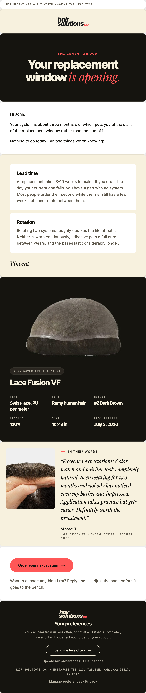

<!-- Generated by .claude/skills/shopify-email-html/scripts/build_library.py — edit section.json / template.json instead. -->

# RO-3 · Reorder: your replacement window is opening

| | |
|---|---|
| Code | RO-3 |
| Journey | reorder |
| Surface | Messaging · Code your own |
| Where in Shopify | Not installed yet. Planned: Flow › Replacement window › Send marketing email (Messaging, Code your own) |
| Subject | `Your replacement window is opening.` |
| Preview text | Not urgent yet—but worth knowing the lead time. |
| Timing | RO series starts 60 days after the customer's last purchase (RO-1). RO-3's own delay is not defined; its copy says the system is 'about three months old'. |
| Shopify status | not-installed |
| Shopify matches this repo | **no — re-sync Shopify from the file below** |

## Sections (assembly order)

1. [Email head (fonts + styles)](../../email-blocks/00-email-head-fonts-styles/) — `00-email-head-fonts-styles`
2. [RO-3 · Preheader bar](../../email-blocks/ro-3-preheader-bar/) — `ro-3-preheader-bar`
3. [Logo header](../../email-blocks/02-logo-header/) — `02-logo-header`
4. [RO-3 · Hero](../../email-blocks/ro-3-hero/) — `ro-3-hero`
5. [RO-3 · Intro](../../email-blocks/ro-3-intro/) — `ro-3-intro`
6. [RO-3 · Lead time and rotation](../../email-blocks/ro-3-lead-time-rotation/) — `ro-3-lead-time-rotation`
7. [RO-3 · Saved specification](../../email-blocks/ro-3-saved-spec/) — `ro-3-saved-spec`
8. [RO-3 · Testimonial (Michael T.)](../../email-blocks/ro-3-testimonial/) — `ro-3-testimonial`
9. [RO-3 · CTA](../../email-blocks/ro-3-cta/) — `ro-3-cta`
10. [Preferences footer](../../email-blocks/06-preferences-footer/) — `06-preferences-footer`

## Code to install

- [`template.html`](template.html)

## Open blockers

- The saved-specification card needs six customer metafields that do not exist yet (custom.spec_system, spec_base, spec_hair, spec_colour, spec_density, spec_size); see the issue. The card hides itself when custom.spec_system is blank.
- Metafield access in Messaging could not be verified in the preview; test with a real customer before activation.
- Testimonial is a real review (Michael T., Lace Fusion VF) but not about rotating two systems, as the design asks.
- 'Order your next system' button points to the homepage for now (see the button-links issue).
- Design's 'View in browser' link is omitted: Shopify Messaging has no variable for it.
- Series trigger confirmed (60 days after last purchase). The delay for RO-3 itself is not defined; RO-1 and RO-2 are not designed or built.

## Preview

## Rebuild

Edit `template.json` (`sections` is the recipe) or a section, then run `python3 .claude/skills/shopify-email-html/scripts/build_library.py` from the repo root.
