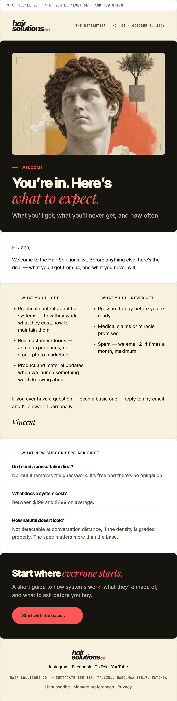

<!-- Generated by .claude/skills/shopify-email-html/scripts/build_library.py — edit section.json / template.json instead. -->

# W-1 · Welcome: what to expect

| | |
|---|---|
| Code | W-1 |
| Journey | welcome |
| Surface | Messaging · Custom Liquid sections |
| Where in Shopify | Flow › "Welcome email on email marketing subscribe" (inactive draft) › Send marketing email (Messaging, Custom Liquid sections, 8 sections). "Welcome email on first order" still holds an earlier Code your own draft of W-1. |
| Subject | `You’re in. Here’s what to expect.` |
| Preview text | What you’ll get, what you’ll never get, and how often. |
| Timing | Immediately after a customer subscribes to email marketing or places their first order, whichever comes first (two workflows share a welcome-email-sent customer tag) |
| Shopify status | draft |
| Shopify matches this repo | yes |

## Sections (assembly order)

1. [Email head (fonts + styles)](../../email-blocks/00-email-head-fonts-styles/) — `00-email-head-fonts-styles`
2. [W-1 · Preheader bar](../../email-blocks/w-1-preheader-bar/) — `w-1-preheader-bar`
3. [W-1 · Masthead](../../email-blocks/w-1-masthead/) — `w-1-masthead`
4. [W-1 · Hero](../../email-blocks/w-1-hero/) — `w-1-hero`
5. [W-1 · Intro](../../email-blocks/w-1-intro/) — `w-1-intro`
6. [W-1 · What you'll get / never get](../../email-blocks/w-1-get-never-get/) — `w-1-get-never-get`
7. [W-1 · What new subscribers ask first](../../email-blocks/w-1-faq/) — `w-1-faq`
8. [W-1 · CTA band](../../email-blocks/w-1-cta-band/) — `w-1-cta-band`
9. [v6 · Footer (paper, social links)](../../email-blocks/v6-footer-paper-social/) — `v6-footer-paper-social`

## Code to install

One Shopify Messaging **Custom Liquid** section per file, in this order:

- [`custom-liquid/01.html`](custom-liquid/01.html)
- [`custom-liquid/02.html`](custom-liquid/02.html)
- [`custom-liquid/03.html`](custom-liquid/03.html)
- [`custom-liquid/04.html`](custom-liquid/04.html)
- [`custom-liquid/05.html`](custom-liquid/05.html)
- [`custom-liquid/06.html`](custom-liquid/06.html)
- [`custom-liquid/07.html`](custom-liquid/07.html)
- [`custom-liquid/08.html`](custom-liquid/08.html)

## Open blockers

- 'Start with the basics' button points to the homepage for now (see the button-links issue).
- Hero image is a crop of the Figma capture; the original file is not available.
- Design's 'View in browser' link is omitted: Shopify Messaging has no variable for it.
- Masthead [ISSUE DATE] is a Liquid date at send time; confirm that is wanted for a welcome email.
- The 'Welcome email on first order' workflow's Send step holds a Code your own draft; it needs a new sections-based Send step (deleting the old step needs Vincent's approval).
- Both welcome workflows were drafted by Shopify Sidekick: they add the customer tag welcome-email-sent, and the tag check uses 'Tags is equal to'. Review before activation; first-order buyers who never opted in to email marketing are skipped by Messaging.
- Sections email shows Shopify's own legal footer under the library footer (as CR-1 does); the Header section is hidden and Content background is transparent.

## Preview

## Rebuild

Edit `template.json` (`sections` is the recipe) or a section, then run `python3 .claude/skills/shopify-email-html/scripts/build_library.py` from the repo root.
