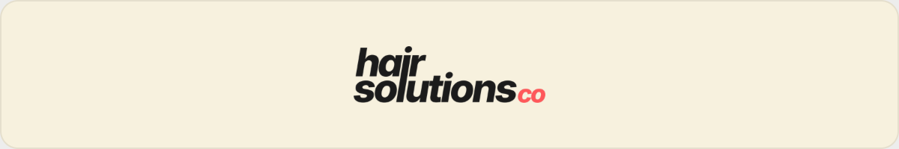

<!-- Generated by .claude/skills/shopify-email-html/scripts/build_library.py — edit section.json / template.json instead. -->

# Logo header

| | |
|---|---|
| Type | Logo header |
| Context | any |
| Surfaces | Messaging · Code your own, Messaging section, Notification template |
| Liquid variables | — |
| Shopify status | live |
| Placeholders | no |
| Characters | 827 |
| Used by | [C-0](../../emails/c-0-consultation-recap/), [CR-1](../../emails/cr-1-your-carts-still-here/), [CR-2](../../emails/cr-2-three-questions-answered/), [CR-3](../../emails/cr-3-not-sure-you-picked-right/), [CR-4](../../emails/cr-4-last-note-free-shipping/), [PP-1](../../emails/pp-1-order-confirmation/), [RO-3](../../emails/ro-3-replacement-window/), [WB-2](../../emails/wb-2-whats-changed/) |

## Preview



## HTML

Source: [`section.html`](section.html). Copy from here or from the raw file.

```html
<table role="presentation" width="100%" cellpadding="0" cellspacing="0" border="0" style="background-color:transparent;"><tr><td align="center" style="padding:0;">
<table role="presentation" class="shell" width="100%" cellpadding="0" cellspacing="0" border="0" style="width:100%;max-width:600px;">
<tr><td style="padding:0;">
<table role="presentation" width="100%" cellpadding="0" cellspacing="0" border="0" style="border-collapse:separate;background-color:#f7f1de;border:1px solid #e5dfcd;border-radius:12px;">
<tr><td class="pad" style="padding:30px 40px;"></td></tr>
</table>
</td></tr>
</table>
</td></tr></table>
```
