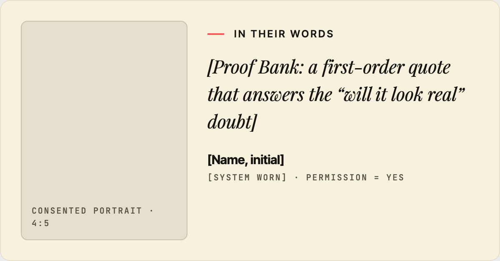

<!-- Generated by .claude/skills/shopify-email-html/scripts/build_library.py — edit section.json / template.json instead. -->

# CR-2 · Testimonial

| | |
|---|---|
| Type | Testimonial |
| Context | any |
| Surfaces | Messaging · Code your own, Messaging section |
| Liquid variables | `proof_meta`, `proof_name`, `proof_portrait`, `proof_quote` |
| Shopify status | draft |
| Placeholders | yes — do not ship as is |
| Characters | 3105 |
| Used by | [CR-2](../../emails/cr-2-three-questions-answered/) |

> Contains placeholder testimonial copy ([Proof Bank ...]). Replace with an approved quote before sending.

## Preview



## HTML

Source: [`section.html`](section.html). Copy from here or from the raw file.

```html
<table role="presentation" width="100%" cellpadding="0" cellspacing="0" border="0" style="background-color:transparent;"><tr><td align="center" style="padding:0;">
<table role="presentation" class="shell" width="100%" cellpadding="0" cellspacing="0" border="0" style="width:100%;max-width:600px;">
<tr><td style="padding:0;">
<table role="presentation" width="100%" cellpadding="0" cellspacing="0" border="0" style="border-collapse:separate;background-color:#f7f1de;border:1px solid #e5dfcd;border-radius:12px;">
<tr><td class="pad" style="padding:24px;"><table role="presentation" width="100%" cellpadding="0" cellspacing="0" border="0"><tr>
<td class="stack" width="200" valign="top" style="width:200px;vertical-align:top;">
<table role="presentation" width="200" cellpadding="0" cellspacing="0" border="0" style="border-collapse:separate;width:200px;height:250px;background-color:#e5dfcd;border:1px solid #c9c1ae;border-radius:8px;">
<tr><td valign="bottom" style="height:250px;padding:0 12px 12px 12px;vertical-align:bottom;"><p style="margin:0 0 0px 0;font-family:'JetBrains Mono','Courier New',monospace;font-size:10px;line-height:15px;font-weight:500;letter-spacing:1.4px;text-transform:uppercase;color:#5a5448;text-align:left;">Consented portrait &middot; 4:5</p></td></tr></table></td>
<td class="stack stack-gap" valign="top" style="padding-left:24px;vertical-align:top;padding-top:8px;">
<table role="presentation" cellpadding="0" cellspacing="0" border="0" style="margin:0 0 14px 0;">
<tr><td width="20" style="width:20px;vertical-align:middle;"><div style="height:2px;line-height:2px;font-size:0;background-color:#ff5757;">&nbsp;</div></td>
<td style="padding-left:12px;font-family:'Inter Tight',Arial,Helvetica,sans-serif;font-size:12px;line-height:16px;font-weight:600;letter-spacing:2px;text-transform:uppercase;color:#15140f;white-space:nowrap;">In their words</td></tr>
</table>
<p style="margin:0 0 20px 0;font-family:'Playfair Display',Georgia,'Times New Roman',serif;font-size:22px;line-height:33px;font-weight:400;color:#15140f;text-align:left;font-style:italic;letter-spacing:-0.2px;">{{ proof_quote }}</p>
<p style="margin:0 0 4px 0;font-family:'Inter Tight',Arial,Helvetica,sans-serif;font-size:15px;line-height:20px;font-weight:700;color:#15140f;text-align:left;letter-spacing:-0.2px;">{{ proof_name }}</p>
<p style="margin:0 0 0px 0;font-family:'JetBrains Mono','Courier New',monospace;font-size:10px;line-height:15px;font-weight:500;letter-spacing:1.4px;text-transform:uppercase;color:#5a5448;text-align:left;">{{ proof_meta }}</p>
</td></tr></table></td></tr>
</table>
</td></tr>
</table>
</td></tr></table>
```
