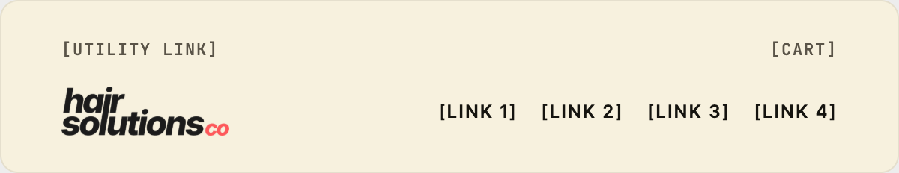
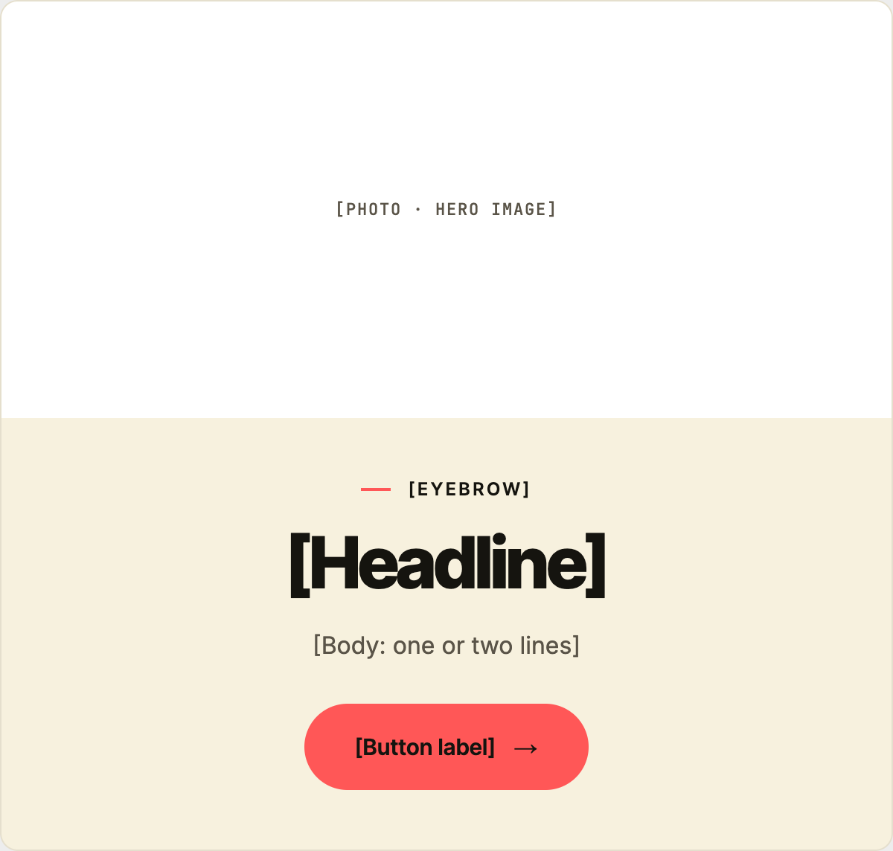
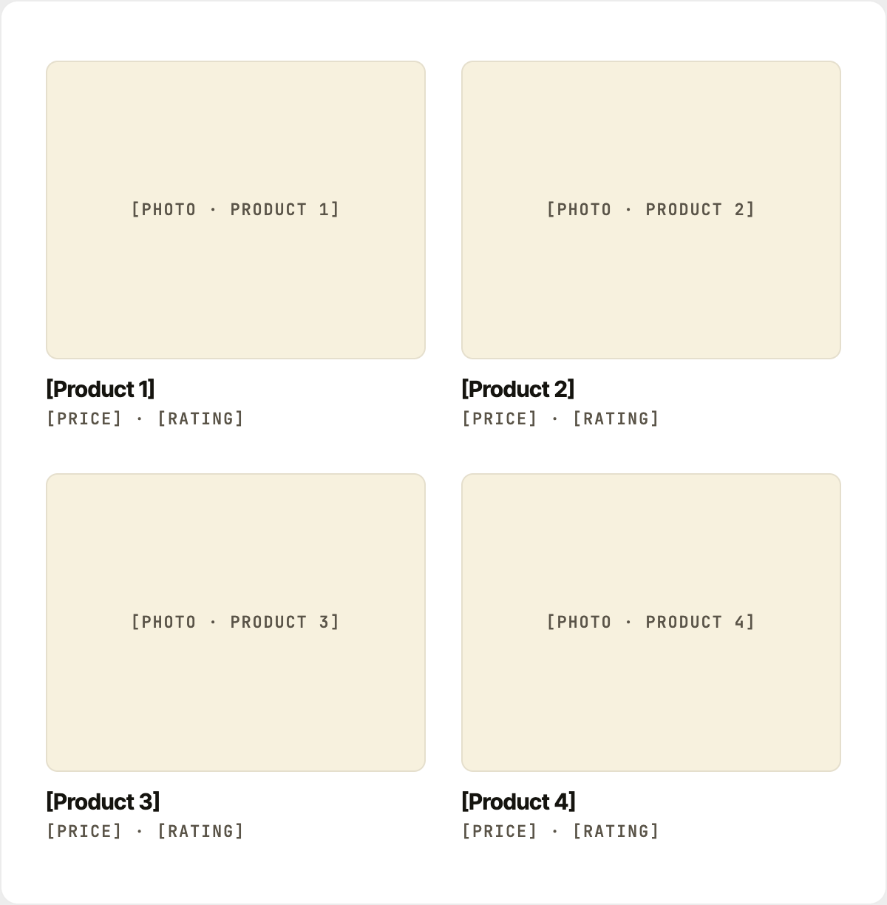
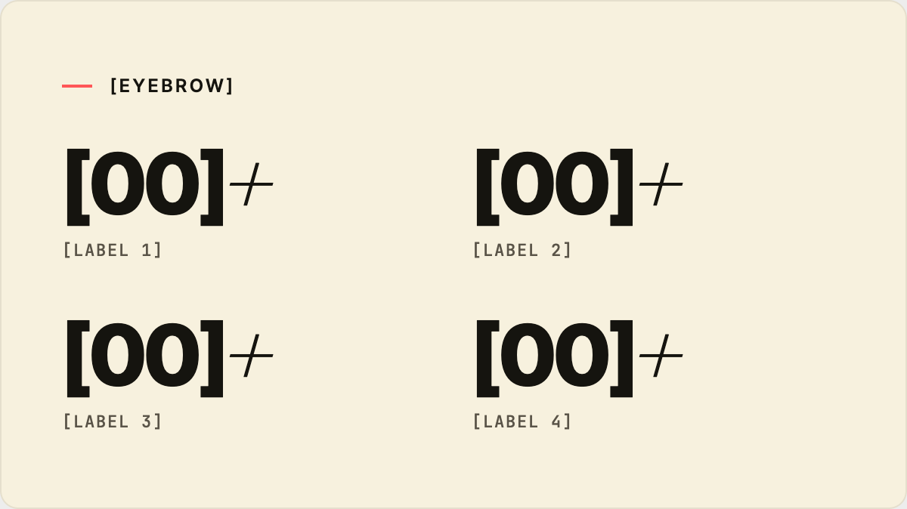
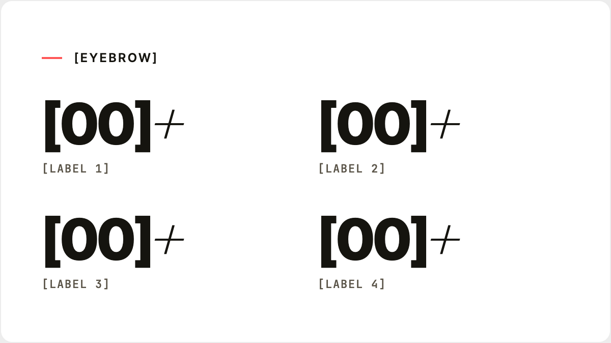
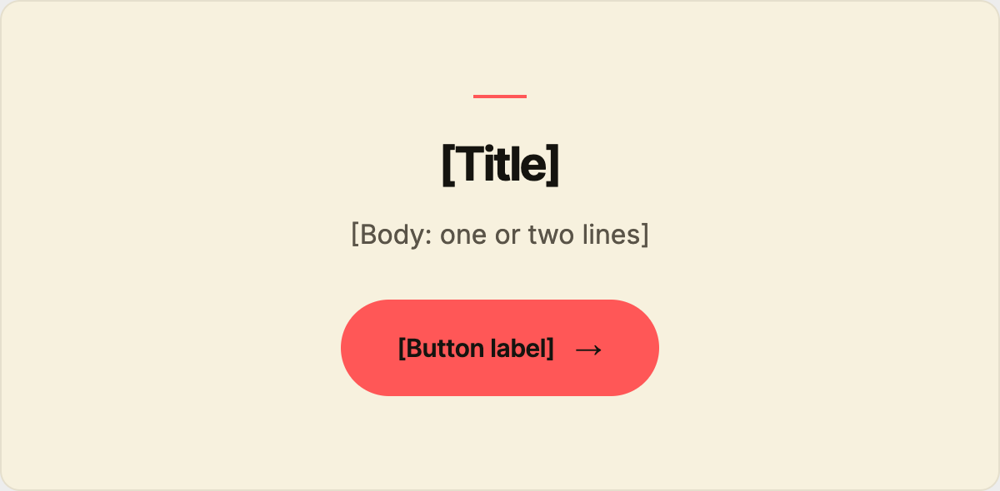
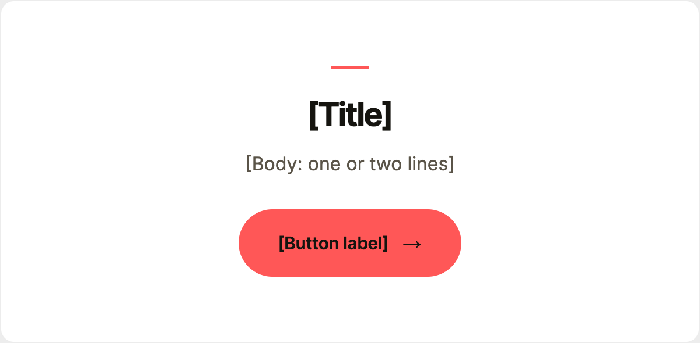
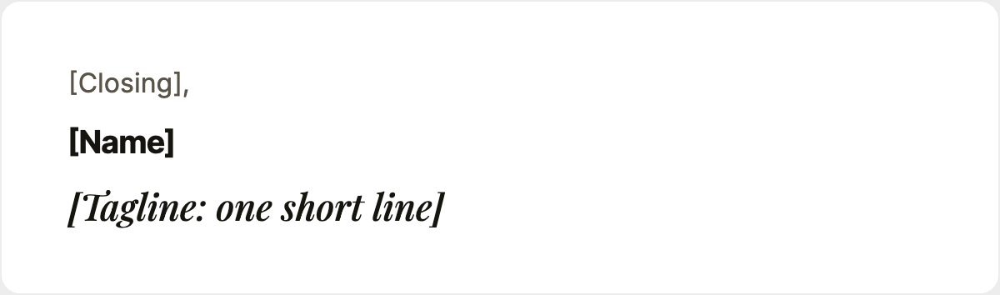

<!-- Generated by .claude/skills/shopify-email-html/scripts/build_library.py — edit section.json / template.json instead. -->

# Email module bank

8 modules in three real themes each (Bone, Ink, White): **24 Shopify Messaging Custom Liquid sections**, each one card (12px corners, flush, transparent outside), built to the v6 email design system from the Figma module library. Copy is a labelled slot (`[Headline]`): replace it before use.

Every section is generated by [`templates/module-bank/build_bank.py`](../module-bank/build_bank.py); change the module function, never the section files. Sortable table: [`bank.tsv`](bank.tsv). How to use and extend it: [`references/module-bank.md`](../../.claude/skills/shopify-email-html/references/module-bank.md).

## 01 · Global chrome

| Module | Bone | Ink | White |
|---|---|---|---|
| **Navigation · Utility bar with links** |  `mb-01-navigation-utility-bar-with-links-bone` |  `mb-01-navigation-utility-bar-with-links-ink` |  `mb-01-navigation-utility-bar-with-links-white` |

## 02 · Heroes

| Module | Bone | Ink | White |
|---|---|---|---|
| **Hero · Image with text below** |  `mb-02-hero-image-with-text-below-bone` |  `mb-02-hero-image-with-text-below-ink` |  `mb-02-hero-image-with-text-below-white` |

## 03 · Titles & editorial

| Module | Bone | Ink | White |
|---|---|---|---|
| **Title · Centred with short rule** |  `mb-03-title-centred-with-short-rule-bone` |  `mb-03-title-centred-with-short-rule-ink` |  `mb-03-title-centred-with-short-rule-white` |

## 04 · Products & commerce

| Module | Bone | Ink | White |
|---|---|---|---|
| **Product · Two by two grid** |  `mb-04-product-two-by-two-grid-bone` |  `mb-04-product-two-by-two-grid-ink` |  `mb-04-product-two-by-two-grid-white` |

## 05 · Services & proof

| Module | Bone | Ink | White |
|---|---|---|---|
| **Service · Stats band** |  `mb-05-service-stats-band-bone` |  `mb-05-service-stats-band-ink` |  `mb-05-service-stats-band-white` |

## 06 · CTAs & promotions

| Module | Bone | Ink | White |
|---|---|---|---|
| **CTA · Centred panel with rule** |  `mb-06-cta-centred-panel-with-rule-bone` |  `mb-06-cta-centred-panel-with-rule-ink` |  `mb-06-cta-centred-panel-with-rule-white` |

## 07 · Transactional lifecycle

| Module | Bone | Ink | White |
|---|---|---|---|
| **Order · Shipping tracker** |  `mb-07-order-shipping-tracker-bone` |  `mb-07-order-shipping-tracker-ink` |  `mb-07-order-shipping-tracker-white` |

## 08 · Utility

| Module | Bone | Ink | White |
|---|---|---|---|
| **Utility · Sign-off** |  `mb-08-utility-sign-off-bone` |  `mb-08-utility-sign-off-ink` |  `mb-08-utility-sign-off-white` |
