<!-- Generated by .claude/skills/shopify-email-html/scripts/build_library.py — edit section.json / template.json instead. -->

# Email sections

The sections database: every reusable block of a Shopify email, with its exact HTML and a preview. Each folder holds `section.html` (the code), `section.json` (its properties) and `preview.png`.

Sortable table: [`index.tsv`](index.tsv). Templates that use these sections: [`../emails/`](../emails/).

All previews are 1200px wide (600px email at 2×). Every card stacks flush with the next one (no gap), has 12px corners and no background behind it.

## Email head

| Preview | Section | Context | Used by | Status |
|---|---|---|---|---|
| — (no visual output) | [Email head (fonts + styles)](00-email-head-fonts-styles/) `00-email-head-fonts-styles` | any | [CR-1](../emails/cr-1-your-carts-still-here/), [CR-2](../emails/cr-2-three-questions-answered/), [CR-3](../emails/cr-3-not-sure-you-picked-right/), [CR-4](../emails/cr-4-last-note-free-shipping/), [PP-1](../emails/pp-1-order-confirmation/) | live |

## Preheader bar

| Preview | Section | Context | Used by | Status |
|---|---|---|---|---|
|  | [CR-1 · Preheader bar](01-cr-1-preheader-bar/) `01-cr-1-preheader-bar` | abandoned-checkout | [CR-1](../emails/cr-1-your-carts-still-here/) | draft |
|  | [CR-2 · Preheader bar](07-cr-2-preheader-bar/) `07-cr-2-preheader-bar` | abandoned-checkout | [CR-2](../emails/cr-2-three-questions-answered/) | draft |
|  | [CR-3 · Preheader bar](14-cr-3-preheader-bar/) `14-cr-3-preheader-bar` | any | [CR-3](../emails/cr-3-not-sure-you-picked-right/) | draft |
|  | [CR-4 · Preheader bar](20-cr-4-preheader-bar/) `20-cr-4-preheader-bar` | abandoned-checkout | [CR-4](../emails/cr-4-last-note-free-shipping/) | draft |
|  | [PP-1 · Preheader bar](25-pp-1-preheader-bar/) `25-pp-1-preheader-bar` | order | [PP-1](../emails/pp-1-order-confirmation/) | live |

## Logo header

| Preview | Section | Context | Used by | Status |
|---|---|---|---|---|
|  | [Logo header](02-logo-header/) `02-logo-header` | any | [CR-1](../emails/cr-1-your-carts-still-here/), [CR-2](../emails/cr-2-three-questions-answered/), [CR-3](../emails/cr-3-not-sure-you-picked-right/), [CR-4](../emails/cr-4-last-note-free-shipping/), [PP-1](../emails/pp-1-order-confirmation/) | live |

## Text

| Preview | Section | Context | Used by | Status |
|---|---|---|---|---|
| 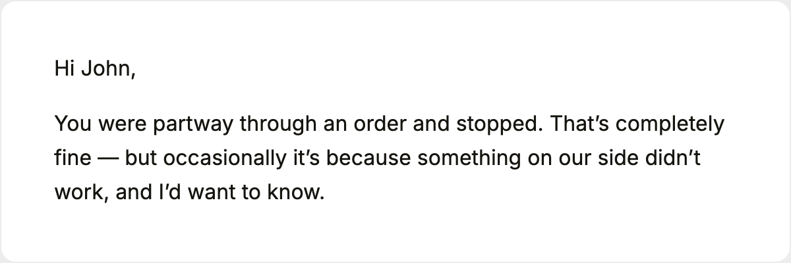 | [CR-1 · Greeting](03-cr-1-greeting/) `03-cr-1-greeting` | any | [CR-1](../emails/cr-1-your-carts-still-here/) | draft |
| 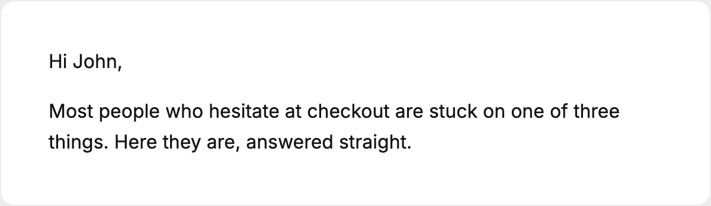 | [CR-2 · Intro](08-cr-2-intro/) `08-cr-2-intro` | any | [CR-2](../emails/cr-2-three-questions-answered/) | draft |
| 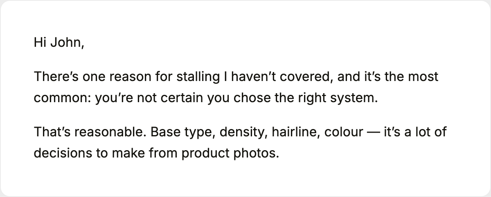 | [CR-3 · Intro](15-cr-3-intro/) `15-cr-3-intro` | any | [CR-3](../emails/cr-3-not-sure-you-picked-right/) | draft |
|  | [CR-4 · Intro](21-cr-4-intro/) `21-cr-4-intro` | any | [CR-4](../emails/cr-4-last-note-free-shipping/) | draft |
| 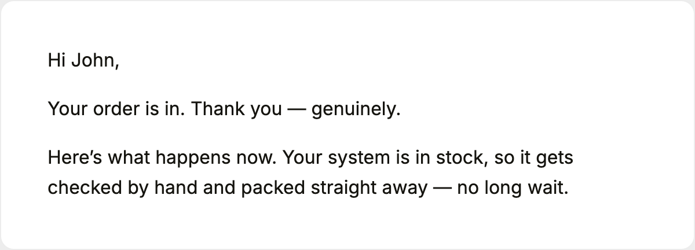 | [PP-1 · Intro](27-pp-1-intro/) `27-pp-1-intro` | order | [PP-1](../emails/pp-1-order-confirmation/) | live |

## Cart contents

| Preview | Section | Context | Used by | Status |
|---|---|---|---|---|
| 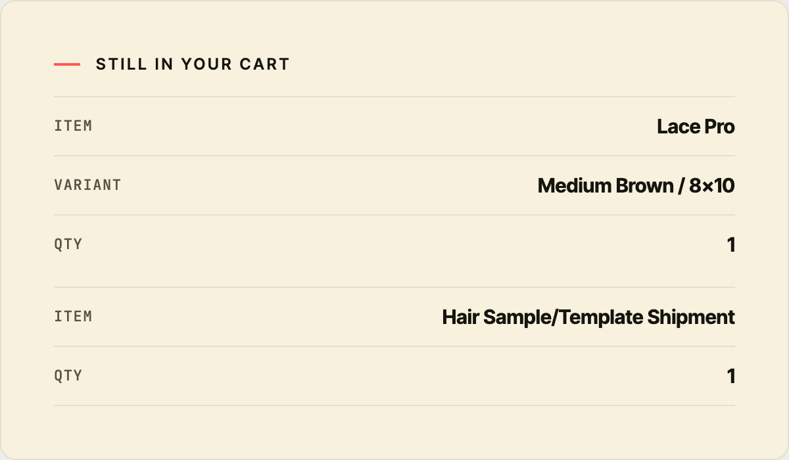 | [Cart contents](04-cart-contents/) `04-cart-contents` | abandoned-checkout | [CR-1](../emails/cr-1-your-carts-still-here/), [CR-2](../emails/cr-2-three-questions-answered/), [CR-4](../emails/cr-4-last-note-free-shipping/) | draft |

## Sign-off + CTA

| Preview | Section | Context | Used by | Status |
|---|---|---|---|---|
| 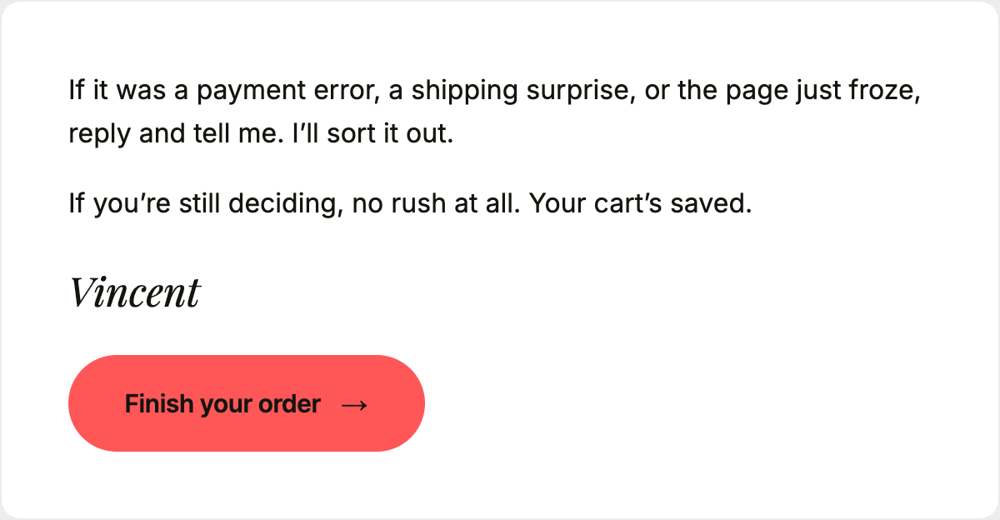 | [CR-1 · Sign-off + CTA](05-cr-1-sign-off-cta/) `05-cr-1-sign-off-cta` | abandoned-checkout | [CR-1](../emails/cr-1-your-carts-still-here/) | draft |
| 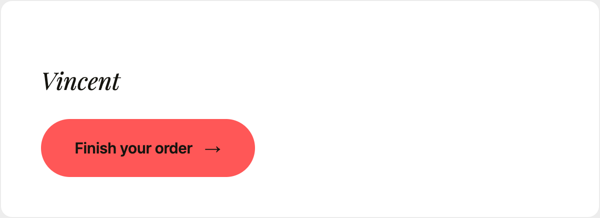 | [CR-2 · Sign-off + CTA](13-cr-2-sign-off-cta/) `13-cr-2-sign-off-cta` | abandoned-checkout | [CR-2](../emails/cr-2-three-questions-answered/) | draft |
| 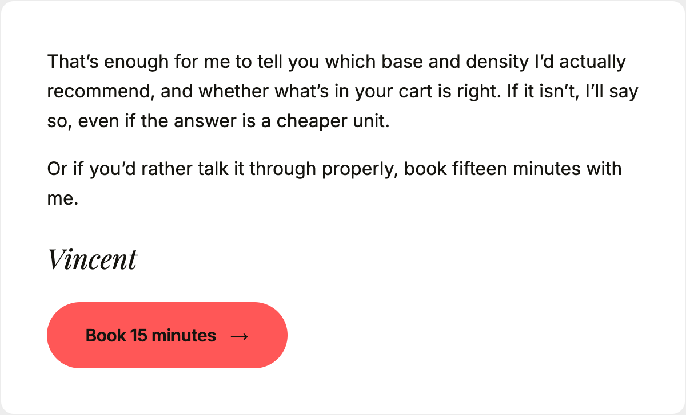 | [CR-3 · Sign-off + CTA](17-cr-3-sign-off-cta/) `17-cr-3-sign-off-cta` | any | [CR-3](../emails/cr-3-not-sure-you-picked-right/) | draft |
| 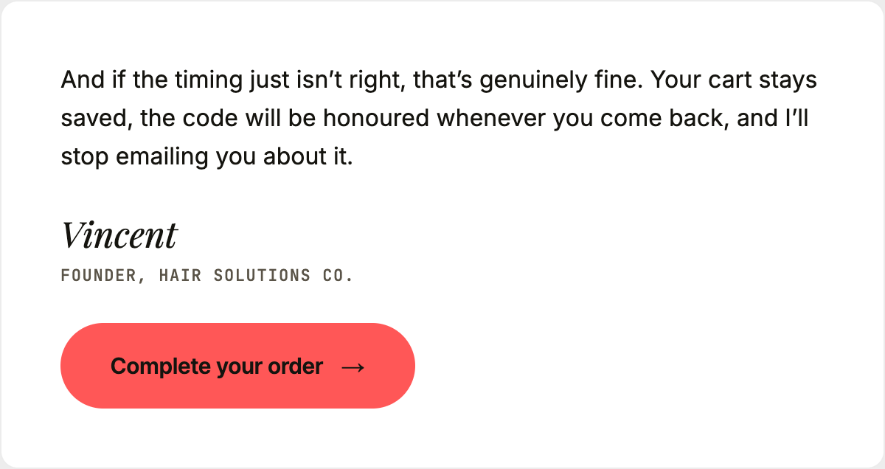 | [CR-4 · Sign-off + CTA](23-cr-4-sign-off-cta/) `23-cr-4-sign-off-cta` | abandoned-checkout | [CR-4](../emails/cr-4-last-note-free-shipping/) | draft |

## Preferences footer

| Preview | Section | Context | Used by | Status |
|---|---|---|---|---|
|  | [Preferences footer](06-preferences-footer/) `06-preferences-footer` | any | [CR-1](../emails/cr-1-your-carts-still-here/), [CR-2](../emails/cr-2-three-questions-answered/), [CR-3](../emails/cr-3-not-sure-you-picked-right/), [CR-4](../emails/cr-4-last-note-free-shipping/) | draft |
|  | [PP-1 · Preferences footer](33-pp-1-preferences-footer/) `33-pp-1-preferences-footer` | any | [PP-1](../emails/pp-1-order-confirmation/) | live |

## FAQ

| Preview | Section | Context | Used by | Status |
|---|---|---|---|---|
| 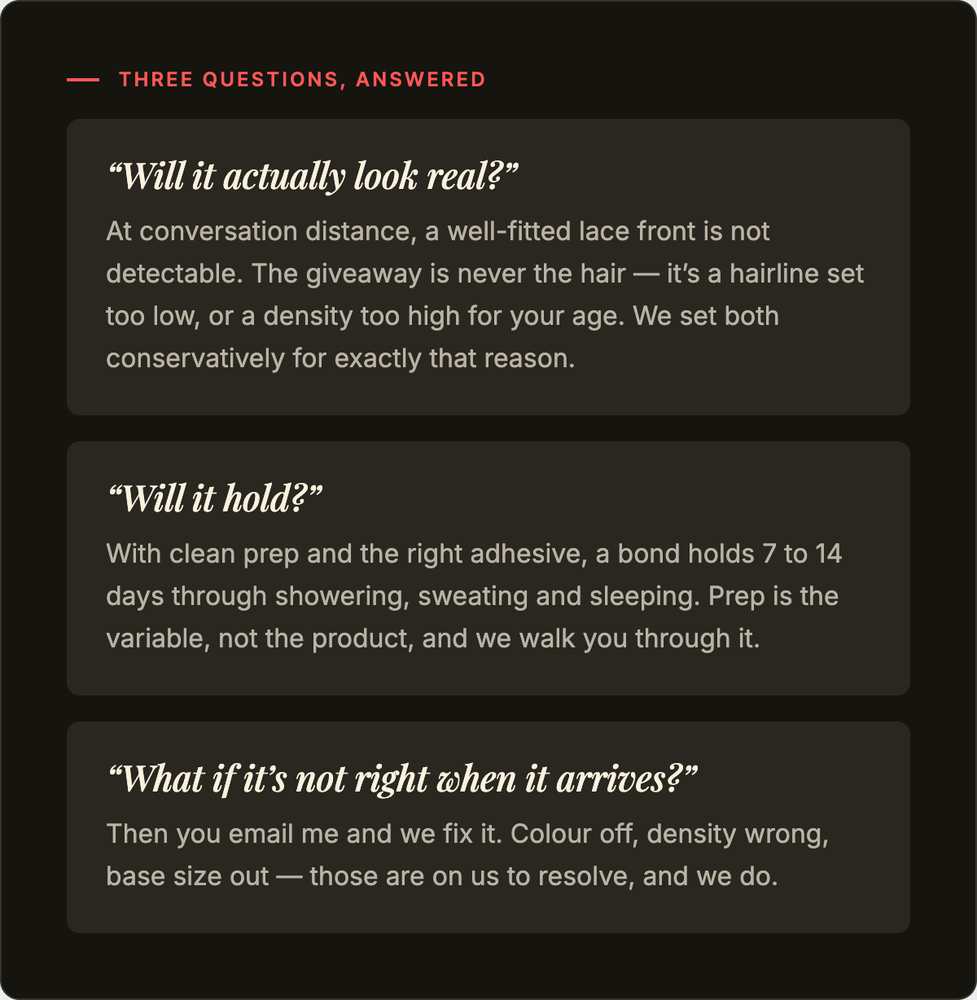 | [CR-2 · Three questions (FAQ)](09-cr-2-three-questions-faq/) `09-cr-2-three-questions-faq` | any | [CR-2](../emails/cr-2-three-questions-answered/) | draft |

## Photo + caption

| Preview | Section | Context | Used by | Status |
|---|---|---|---|---|
| 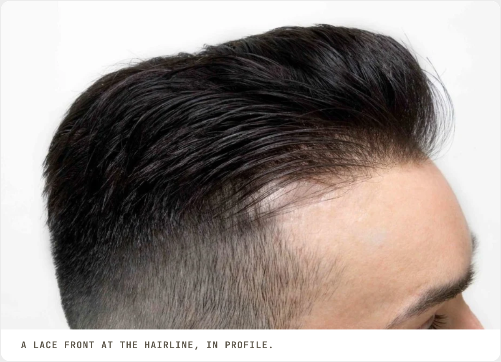 | [CR-2 · Photo + caption](10-cr-2-photo-caption/) `10-cr-2-photo-caption` | any | [CR-2](../emails/cr-2-three-questions-answered/) | draft |
| 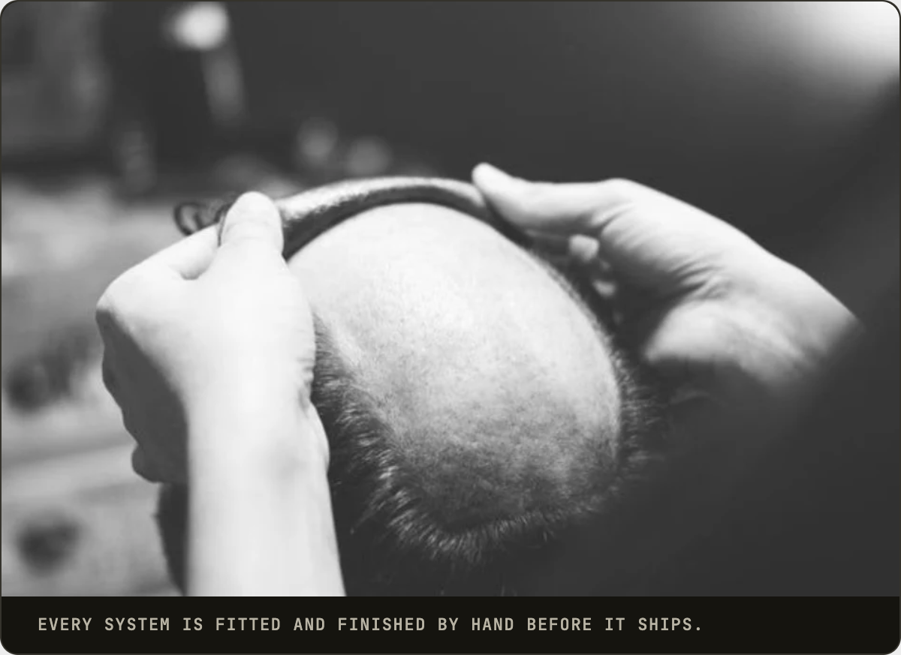 | [PP-1 · Photo + caption](29-pp-1-photo-caption/) `29-pp-1-photo-caption` | any | [PP-1](../emails/pp-1-order-confirmation/) | live |

## Trust strip

| Preview | Section | Context | Used by | Status |
|---|---|---|---|---|
|  | [Trust strip](11-trust-strip/) `11-trust-strip` | any | [CR-2](../emails/cr-2-three-questions-answered/), [CR-3](../emails/cr-3-not-sure-you-picked-right/) | draft |

## Testimonial

| Preview | Section | Context | Used by | Status |
|---|---|---|---|---|
| 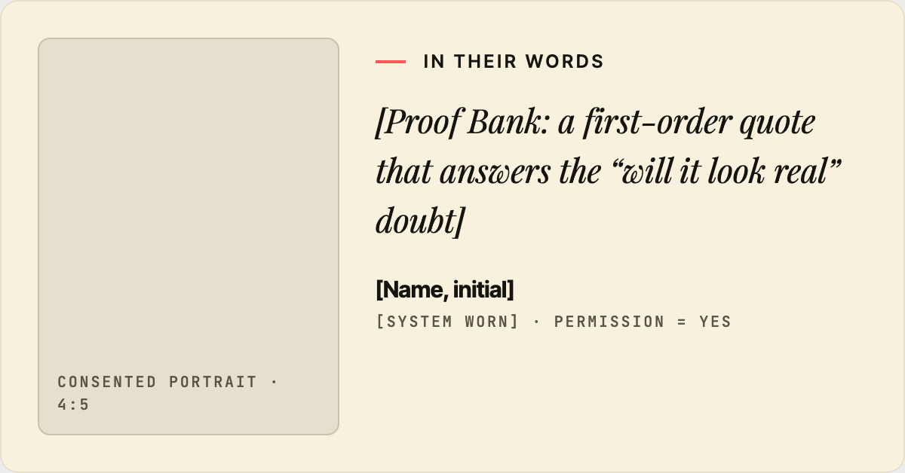 | [CR-2 · Testimonial](12-cr-2-testimonial/) `12-cr-2-testimonial` ⚠️ placeholder | any | [CR-2](../emails/cr-2-three-questions-answered/) | draft |

## Checklist

| Preview | Section | Context | Used by | Status |
|---|---|---|---|---|
| 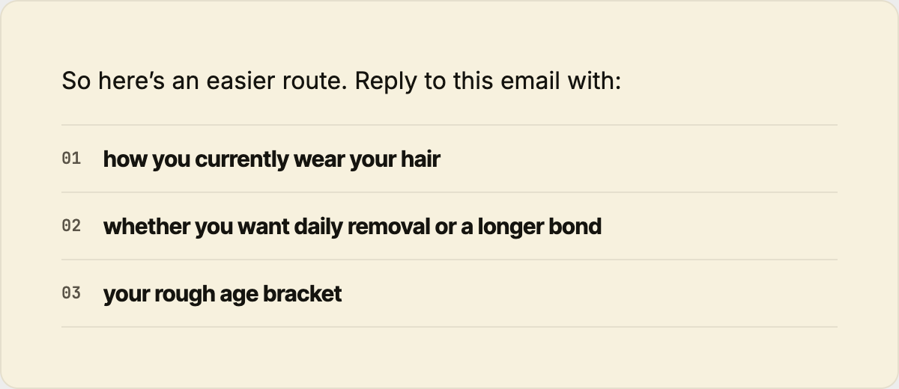 | [CR-3 · Reply checklist](16-cr-3-reply-checklist/) `16-cr-3-reply-checklist` | any | [CR-3](../emails/cr-3-not-sure-you-picked-right/) | draft |

## Ink note

| Preview | Section | Context | Used by | Status |
|---|---|---|---|---|
| 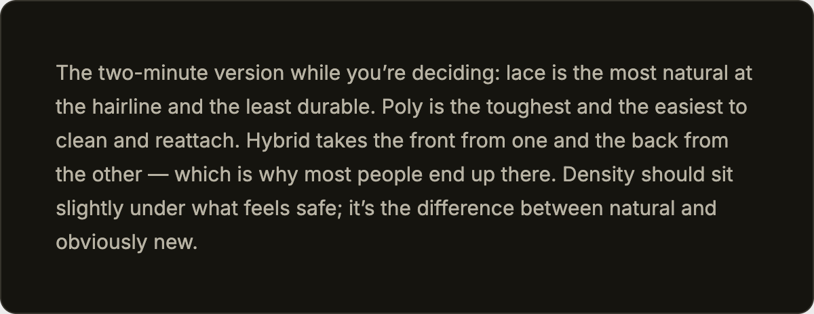 | [CR-3 · Ink note](18-cr-3-ink-note/) `18-cr-3-ink-note` | any | [CR-3](../emails/cr-3-not-sure-you-picked-right/) | draft |

## Product reminder

| Preview | Section | Context | Used by | Status |
|---|---|---|---|---|
| 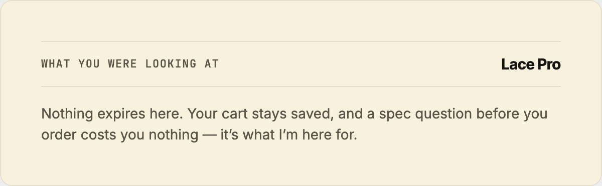 | [CR-3 · Product reminder](19-cr-3-product-reminder/) `19-cr-3-product-reminder` | abandoned-checkout | [CR-3](../emails/cr-3-not-sure-you-picked-right/) | draft |

## Discount code

| Preview | Section | Context | Used by | Status |
|---|---|---|---|---|
| 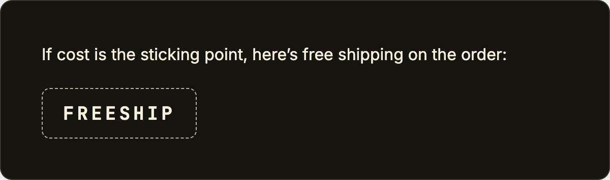 | [CR-4 · Discount code](22-cr-4-discount-code/) `22-cr-4-discount-code` | any | [CR-4](../emails/cr-4-last-note-free-shipping/) | draft |

## Liquid header

| Preview | Section | Context | Used by | Status |
|---|---|---|---|---|
| — (no visual output) | [PP-1 Liquid header (order variables + lead times)](24-pp-1-liquid-header-order-variables-lead-times/) `24-pp-1-liquid-header-order-variables-lead-times` | order | [PP-1](../emails/pp-1-order-confirmation/) | live |

## Hero

| Preview | Section | Context | Used by | Status |
|---|---|---|---|---|
|  | [PP-1 · Hero](26-pp-1-hero/) `26-pp-1-hero` | order | [PP-1](../emails/pp-1-order-confirmation/) | live |

## Order summary

| Preview | Section | Context | Used by | Status |
|---|---|---|---|---|
| 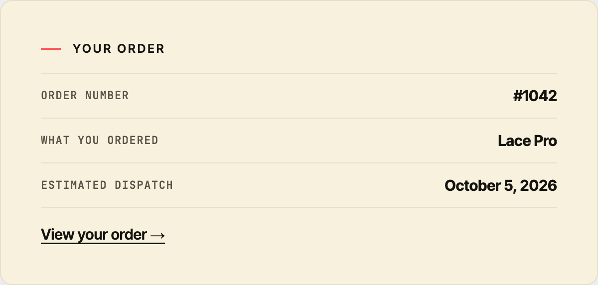 | [PP-1 · Order summary](28-pp-1-order-summary/) `28-pp-1-order-summary` | order | [PP-1](../emails/pp-1-order-confirmation/) | live |

## Timeline

| Preview | Section | Context | Used by | Status |
|---|---|---|---|---|
| 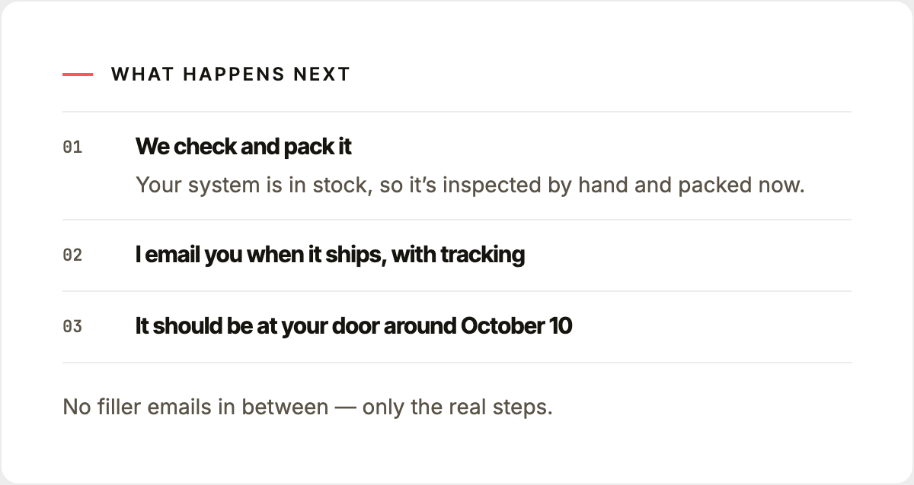 | [PP-1 · Timeline](30-pp-1-timeline/) `30-pp-1-timeline` | order | [PP-1](../emails/pp-1-order-confirmation/) | live |

## Signature

| Preview | Section | Context | Used by | Status |
|---|---|---|---|---|
|  | [PP-1 · Signature](31-pp-1-signature/) `31-pp-1-signature` | order | [PP-1](../emails/pp-1-order-confirmation/) | live |

## CTA

| Preview | Section | Context | Used by | Status |
|---|---|---|---|---|
| 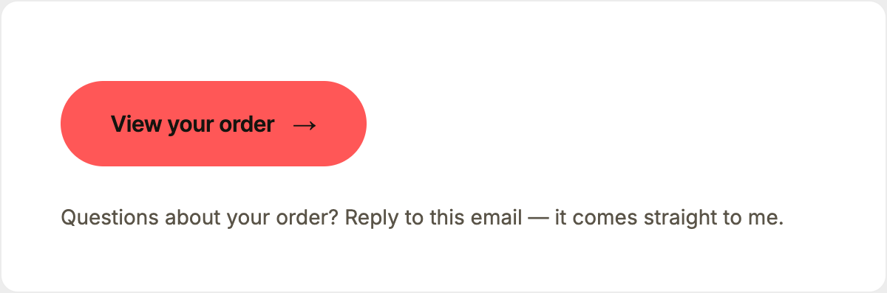 | [PP-1 · CTA](32-pp-1-cta/) `32-pp-1-cta` | order | [PP-1](../emails/pp-1-order-confirmation/) | live |
