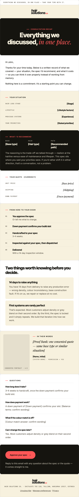
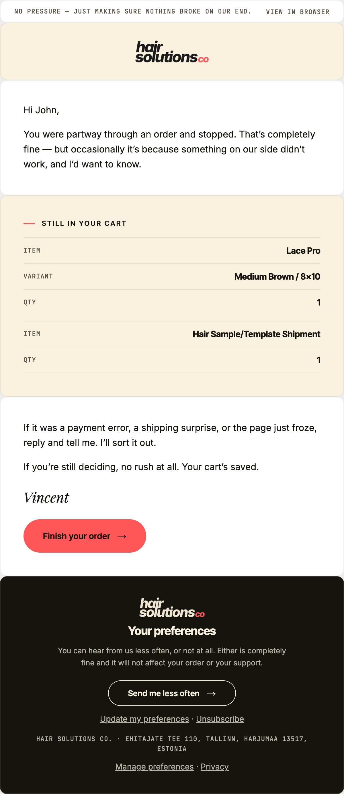
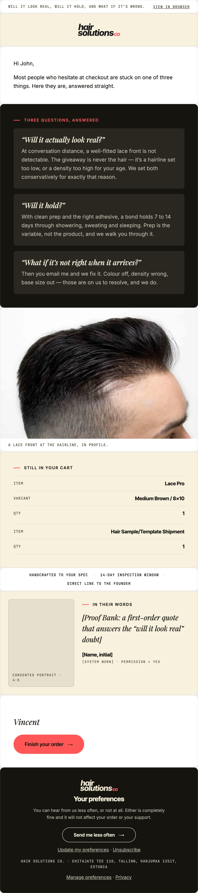
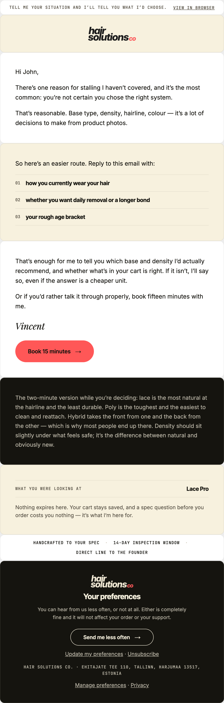
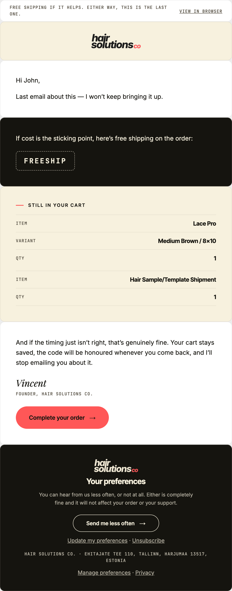
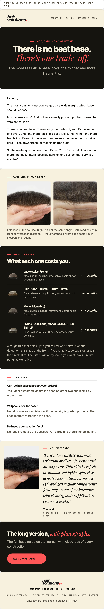
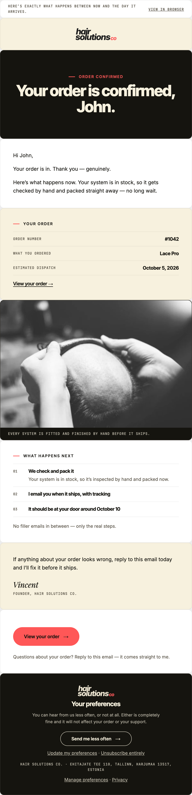
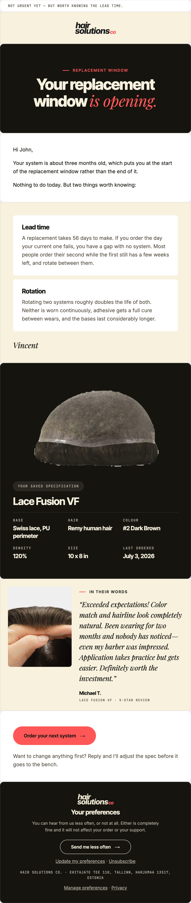
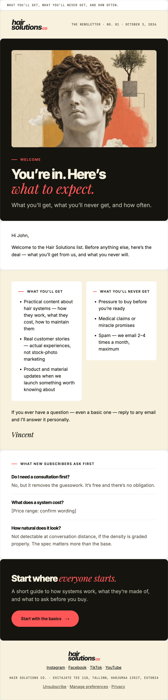
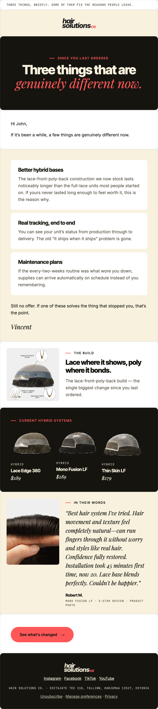

<!-- Generated by .claude/skills/shopify-email-html/scripts/build_library.py — edit section.json / template.json instead. -->

# Email templates

The templates database: every assembled Shopify email. A template is a recipe — the ordered list of sections in `template.json` — and the build turns it into the code you paste into Shopify.

Sortable table: [`index.tsv`](index.tsv). Sections: [`../email-blocks/`](../email-blocks/).

| Preview | Template | Surface | Shopify | Sections |
|---|---|---|---|---|
|  | [C-0 · Consultation recap](c-0-consultation-recap/) After a consultation call (one-to-one; no trigger defined) | Messaging · Code your own | not-installed ⚠️ Shopify out of date | 14 |
|  | [CR-1 · Your cart's still here](cr-1-your-carts-still-here/) Abandon + 4 h | Messaging · Custom Liquid sections | draft | 7 |
|  | [CR-2 · The three things people ask before ordering](cr-2-three-questions-answered/) Abandon + 24 h (wait 72 000 s after CR-1, no order since abandonment) | Messaging · Code your own | draft | 11 |
|  | [CR-3 · Not sure you picked the right one?](cr-3-not-sure-you-picked-right/) Abandon + 48 h (wait 86 400 s after CR-2, no order since abandonment) | Messaging · Code your own | draft | 10 |
|  | [CR-4 · Last note about your cart](cr-4-last-note-free-shipping/) Abandon + 96 h (wait 172 800 s after CR-3, no order since abandonment) | Messaging · Code your own | draft | 8 |
|  | [NL-01 · Education: there is no best base](nl-01-no-best-base/) Manual campaign send (newsletter edition 01, Education) | Messaging · Code your own | draft | 11 |
|  | [PP-1 · Order confirmation](pp-1-order-confirmation/) Sent when an order is placed | Notification template | live | 12 |
|  | [RO-3 · Reorder: your replacement window is opening](ro-3-replacement-window/) About three months after the customer's last order (from the copy: 'about three months old') | Messaging · Code your own | not-installed ⚠️ Shopify out of date | 10 |
|  | [W-1 · Welcome: what to expect](w-1-welcome/) Immediately after a customer subscribes to email marketing | Messaging · Code your own | not-installed ⚠️ Shopify out of date | 9 |
|  | [WB-2 · Win-back: what's changed](wb-2-whats-changed/) Win-back sequence, email 2 (timing not given in the design; confirm) | Messaging · Code your own | not-installed ⚠️ Shopify out of date | 11 |
