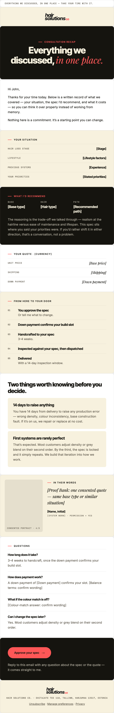

<!-- Generated by .claude/skills/shopify-email-html/scripts/build_library.py — edit section.json / template.json instead. -->

# C-0 · Consultation recap

| | |
|---|---|
| Code | C-0 |
| Journey | consultation |
| Surface | Messaging · Code your own |
| Where in Shopify | Not created in Shopify, on purpose (Vincent, 2026-10-03: post-consultation emails are left alone). |
| Subject | `Everything we discussed, in one place.` |
| Preview text | Take your time with it: your situation, recommendation, quote, and next steps. |
| Timing | After a consultation call (one-to-one; no trigger defined) |
| Shopify status | not-installed |
| Shopify matches this repo | **no — re-sync Shopify from the file below** |

## Sections (assembly order)

1. [Email head (fonts + styles)](../../email-blocks/00-email-head-fonts-styles/) — `00-email-head-fonts-styles`
2. [C-0 · Preheader bar](../../email-blocks/c-0-preheader-bar/) — `c-0-preheader-bar`
3. [Logo header](../../email-blocks/02-logo-header/) — `02-logo-header`
4. [C-0 · Hero](../../email-blocks/c-0-hero/) — `c-0-hero`
5. [C-0 · Intro](../../email-blocks/c-0-intro/) — `c-0-intro`
6. [C-0 · Your situation](../../email-blocks/c-0-situation/) — `c-0-situation`
7. [C-0 · What I'd recommend](../../email-blocks/c-0-recommendation/) — `c-0-recommendation`
8. [C-0 · Your quote](../../email-blocks/c-0-quote/) — `c-0-quote`
9. [C-0 · From here to your door](../../email-blocks/c-0-steps/) — `c-0-steps`
10. [C-0 · Two things worth knowing](../../email-blocks/c-0-two-things/) — `c-0-two-things`
11. [C-0 · Testimonial (proof bank)](../../email-blocks/c-0-testimonial/) — `c-0-testimonial`
12. [C-0 · Questions](../../email-blocks/c-0-questions/) — `c-0-questions`
13. [C-0 · Approve your spec](../../email-blocks/c-0-approve-cta/) — `c-0-approve-cta`
14. [v6 · Footer (paper, no social)](../../email-blocks/v6-footer-paper/) — `v6-footer-paper`

## Code to install

- [`template.html`](template.html)

## Open blockers

- Not to be created in Shopify.
- Most fields are per-customer consultation data (stage, lifestyle, experience, priorities, spec, quote, down payment) with no data source defined.
- Bracketed copy remains: [Balance terms: confirm wording], [Colour-match answer: confirm wording], [CURRENCY], and a proof-bank quote.
- '3-4 weeks' handcrafting time conflicts with the confirmed 56-day custom lead time.
- 'Approve your spec' has no destination page.
- Design's 'View in browser' link is omitted: Shopify Messaging has no variable for it.

## Preview

## Rebuild

Edit `template.json` (`sections` is the recipe) or a section, then run `python3 .claude/skills/shopify-email-html/scripts/build_library.py` from the repo root.
