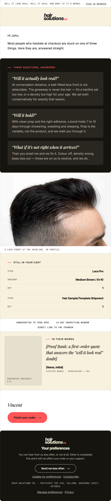

<!-- Generated by .claude/skills/shopify-email-html/scripts/build_library.py — edit section.json / template.json instead. -->

# CR-2 · The three things people ask before ordering

| | |
|---|---|
| Code | CR-2 |
| Journey | cart-recovery |
| Surface | Messaging · Code your own |
| Where in Shopify | Flow › Recover abandoned checkout › Send marketing email #2 (Messaging, Code your own) |
| Subject | `The three things people ask before ordering` |
| Preview text | Will it look real, will it hold, and what if it's wrong. |
| Timing | Abandon + 24 h (wait 72 000 s after CR-1, no order since abandonment) |
| Shopify status | draft |
| Shopify matches this repo | **no — re-sync Shopify from the file below** |

## Sections (assembly order)

1. [Email head (fonts + styles)](../../email-blocks/00-email-head-fonts-styles/) — `00-email-head-fonts-styles`
2. [CR-2 · Preheader bar](../../email-blocks/07-cr-2-preheader-bar/) — `07-cr-2-preheader-bar`
3. [Logo header](../../email-blocks/02-logo-header/) — `02-logo-header`
4. [CR-2 · Intro](../../email-blocks/08-cr-2-intro/) — `08-cr-2-intro`
5. [CR-2 · Three questions (FAQ)](../../email-blocks/09-cr-2-three-questions-faq/) — `09-cr-2-three-questions-faq`
6. [CR-2 · Photo + caption](../../email-blocks/10-cr-2-photo-caption/) — `10-cr-2-photo-caption`
7. [Cart contents](../../email-blocks/04-cart-contents/) — `04-cart-contents`
8. [Trust strip](../../email-blocks/11-trust-strip/) — `11-trust-strip`
9. [CR-2 · Testimonial](../../email-blocks/12-cr-2-testimonial/) — `12-cr-2-testimonial`
10. [CR-2 · Sign-off + CTA](../../email-blocks/13-cr-2-sign-off-cta/) — `13-cr-2-sign-off-cta`
11. [Preferences footer](../../email-blocks/06-preferences-footer/) — `06-preferences-footer`

## Code to install

- [`template.html`](template.html)

## Open blockers

- Testimonial block still holds placeholder copy.
- Shopify draft still has the old 2px gaps; re-sync it from template.html.

## Preview

## Rebuild

Edit `template.json` (`sections` is the recipe) or a section, then run `python3 .claude/skills/shopify-email-html/scripts/build_library.py` from the repo root.
