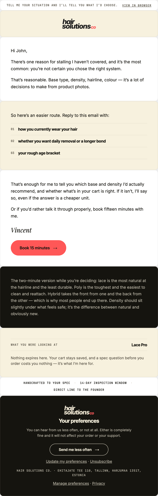

<!-- Generated by .claude/skills/shopify-email-html/scripts/build_library.py — edit section.json / template.json instead. -->

# CR-3 · Not sure you picked the right one?

| | |
|---|---|
| Code | CR-3 |
| Journey | cart-recovery |
| Surface | Messaging · Code your own |
| Where in Shopify | Flow › Recover abandoned checkout › Send marketing email #3 (Messaging, Code your own) |
| Subject | `Not sure you picked the right one?` |
| Preview text | Tell me your situation and I'll tell you what I'd choose. |
| Timing | Abandon + 48 h (wait 86 400 s after CR-2, no order since abandonment) |
| Shopify status | draft |
| Shopify matches this repo | **no — re-sync Shopify from the file below** |

## Sections (assembly order)

1. [Email head (fonts + styles)](../../email-blocks/00-email-head-fonts-styles/) — `00-email-head-fonts-styles`
2. [CR-3 · Preheader bar](../../email-blocks/14-cr-3-preheader-bar/) — `14-cr-3-preheader-bar`
3. [Logo header](../../email-blocks/02-logo-header/) — `02-logo-header`
4. [CR-3 · Intro](../../email-blocks/15-cr-3-intro/) — `15-cr-3-intro`
5. [CR-3 · Reply checklist](../../email-blocks/16-cr-3-reply-checklist/) — `16-cr-3-reply-checklist`
6. [CR-3 · Sign-off + CTA](../../email-blocks/17-cr-3-sign-off-cta/) — `17-cr-3-sign-off-cta`
7. [CR-3 · Ink note](../../email-blocks/18-cr-3-ink-note/) — `18-cr-3-ink-note`
8. [CR-3 · Product reminder](../../email-blocks/19-cr-3-product-reminder/) — `19-cr-3-product-reminder`
9. [Trust strip](../../email-blocks/11-trust-strip/) — `11-trust-strip`
10. [Preferences footer](../../email-blocks/06-preferences-footer/) — `06-preferences-footer`

## Code to install

- [`template.html`](template.html)

## Open blockers

- Shopify draft still has the old 2px gaps; re-sync it from template.html.

## Preview

## Rebuild

Edit `template.json` (`sections` is the recipe) or a section, then run `python3 .claude/skills/shopify-email-html/scripts/build_library.py` from the repo root.
