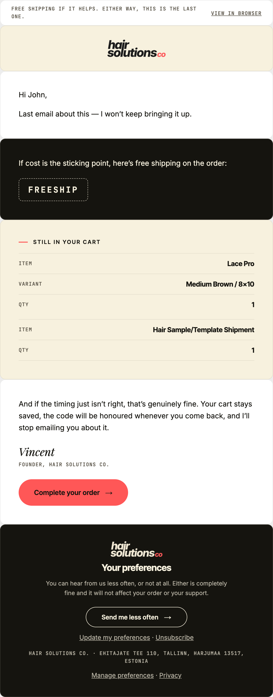

<!-- Generated by .claude/skills/shopify-email-html/scripts/build_library.py — edit section.json / template.json instead. -->

# CR-4 · Last note about your cart

| | |
|---|---|
| Code | CR-4 |
| Journey | cart-recovery |
| Surface | Messaging · Code your own |
| Where in Shopify | Flow › Recover abandoned checkout › Send marketing email #4 (Messaging, Code your own) |
| Subject | `Last note about your cart` |
| Preview text | Free shipping if it helps. Either way, this is the last one. |
| Timing | Abandon + 96 h (wait 172 800 s after CR-3, no order since abandonment) |
| Shopify status | draft |
| Shopify matches this repo | **no — re-sync Shopify from the file below** |

## Sections (assembly order)

1. [Email head (fonts + styles)](../../email-blocks/00-email-head-fonts-styles/) — `00-email-head-fonts-styles`
2. [CR-4 · Preheader bar](../../email-blocks/20-cr-4-preheader-bar/) — `20-cr-4-preheader-bar`
3. [Logo header](../../email-blocks/02-logo-header/) — `02-logo-header`
4. [CR-4 · Intro](../../email-blocks/21-cr-4-intro/) — `21-cr-4-intro`
5. [CR-4 · Discount code](../../email-blocks/22-cr-4-discount-code/) — `22-cr-4-discount-code`
6. [Cart contents](../../email-blocks/04-cart-contents/) — `04-cart-contents`
7. [CR-4 · Sign-off + CTA](../../email-blocks/23-cr-4-sign-off-cta/) — `23-cr-4-sign-off-cta`
8. [Preferences footer](../../email-blocks/06-preferences-footer/) — `06-preferences-footer`

## Code to install

- [`template.html`](template.html)

## Open blockers

- Uses discount code FREESHIP (exists, active).
- Shopify draft still has the old 2px gaps; re-sync it from template.html.

## Preview

## Rebuild

Edit `template.json` (`sections` is the recipe) or a section, then run `python3 .claude/skills/shopify-email-html/scripts/build_library.py` from the repo root.
