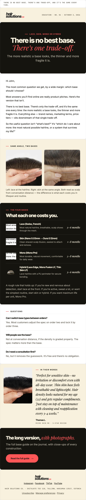

<!-- Generated by .claude/skills/shopify-email-html/scripts/build_library.py — edit section.json / template.json instead. -->

# NL-01 · Education: there is no best base

| | |
|---|---|
| Code | NL-01 |
| Journey | newsletter |
| Surface | Messaging · Code your own |
| Where in Shopify | Messaging › campaign (Code your own). Draft: 'Untitled activity' (editor 77854824) |
| Subject | `There is no best base. There’s one trade-off.` |
| Preview text | The more realistic a base looks, the thinner and more fragile it is. |
| Timing | Manual campaign send (newsletter edition 01, Education) |
| Shopify status | not-installed |
| Shopify matches this repo | **no — re-sync Shopify from the file below** |

## Sections (assembly order)

1. [Email head (fonts + styles)](../../email-blocks/00-email-head-fonts-styles/) — `00-email-head-fonts-styles`
2. [NL-01 · Preheader bar](../../email-blocks/nl-1-preheader-bar/) — `nl-1-preheader-bar`
3. [NL-01 · Masthead](../../email-blocks/nl-1-masthead/) — `nl-1-masthead`
4. [NL-01 · Hero](../../email-blocks/nl-1-hero/) — `nl-1-hero`
5. [NL-01 · Intro](../../email-blocks/nl-1-intro/) — `nl-1-intro`
6. [NL-01 · Same angle, two bases](../../email-blocks/nl-1-two-bases/) — `nl-1-two-bases`
7. [NL-01 · The four bases](../../email-blocks/nl-1-four-bases/) — `nl-1-four-bases`
8. [NL-01 · Questions](../../email-blocks/nl-1-faq/) — `nl-1-faq`
9. [NL-01 · Testimonial (Thomas L.)](../../email-blocks/nl-1-testimonial/) — `nl-1-testimonial`
10. [NL-01 · CTA band](../../email-blocks/nl-1-cta-band/) — `nl-1-cta-band`
11. [v6 · Footer (paper, social links)](../../email-blocks/v6-footer-paper-social/) — `v6-footer-paper-social`

## Code to install

- [`template.html`](template.html)

## Open blockers

- 'Read the full guide' button points to the homepage for now (see the button-links issue).
- Photos and base thumbnails are crops of the Figma capture; the original files are not available.
- Testimonial is a real review (Thomas L., Micro Skin MD) with a product hairline photo; no customer photo exists.
- Design's 'View in browser' link is omitted: Shopify Messaging has no variable for it.
- Lifespan ranges (3-6, 1-8, 5-8 months) are the design's copy; confirm they are factual before sending.

## Preview

## Rebuild

Edit `template.json` (`sections` is the recipe) or a section, then run `python3 .claude/skills/shopify-email-html/scripts/build_library.py` from the repo root.
