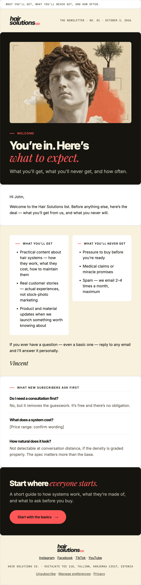

<!-- Generated by .claude/skills/shopify-email-html/scripts/build_library.py — edit section.json / template.json instead. -->

# W-1 · Welcome: what to expect

| | |
|---|---|
| Code | W-1 |
| Journey | welcome |
| Surface | Messaging · Code your own |
| Where in Shopify | Not installed yet. Planned: Flow › Welcome series › Send marketing email #1 (Messaging, Code your own) |
| Subject | `You’re in. Here’s what to expect.` |
| Preview text | What you’ll get, what you’ll never get, and how often. |
| Timing | Immediately after a customer subscribes to email marketing |
| Shopify status | not-installed |
| Shopify matches this repo | **no — re-sync Shopify from the file below** |

## Sections (assembly order)

1. [Email head (fonts + styles)](../../email-blocks/00-email-head-fonts-styles/) — `00-email-head-fonts-styles`
2. [W-1 · Preheader bar](../../email-blocks/w-1-preheader-bar/) — `w-1-preheader-bar`
3. [W-1 · Masthead](../../email-blocks/w-1-masthead/) — `w-1-masthead`
4. [W-1 · Hero](../../email-blocks/w-1-hero/) — `w-1-hero`
5. [W-1 · Intro](../../email-blocks/w-1-intro/) — `w-1-intro`
6. [W-1 · What you'll get / never get](../../email-blocks/w-1-get-never-get/) — `w-1-get-never-get`
7. [W-1 · What new subscribers ask first](../../email-blocks/w-1-faq/) — `w-1-faq`
8. [W-1 · CTA band](../../email-blocks/w-1-cta-band/) — `w-1-cta-band`
9. [v6 · Footer (paper, social links)](../../email-blocks/v6-footer-paper-social/) — `v6-footer-paper-social`

## Code to install

- [`template.html`](template.html)

## Open blockers

- FAQ answer 'What does a system cost?' is still the design's placeholder '[Price range: confirm wording]'; needs Vincent's wording.
- 'Start with the basics' button points to the homepage for now (see the button-links issue).
- Hero image is a crop of the Figma capture; the original file is not available.
- Design's 'View in browser' link is omitted: Shopify Messaging has no variable for it.
- Masthead [ISSUE DATE] is a Liquid date at send time; confirm that is wanted for a welcome email.

## Preview

## Rebuild

Edit `template.json` (`sections` is the recipe) or a section, then run `python3 .claude/skills/shopify-email-html/scripts/build_library.py` from the repo root.
