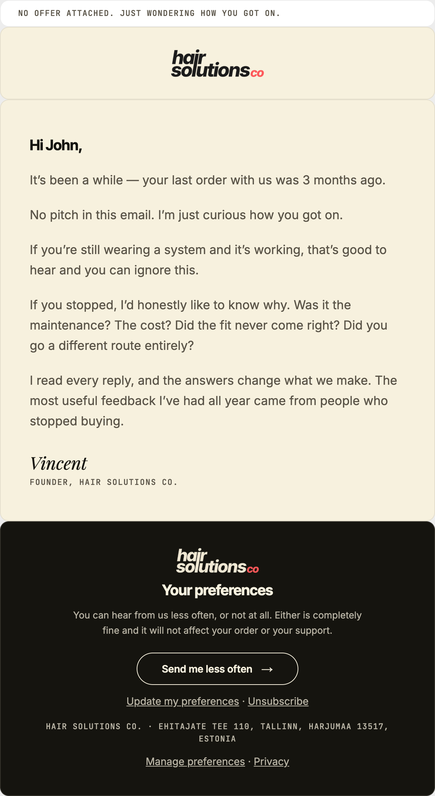

<!-- Generated by .claude/skills/shopify-email-html/scripts/build_library.py — edit section.json / template.json instead. -->

# WB-1 · Win-back: checking in

| | |
|---|---|
| Code | WB-1 |
| Journey | win-back |
| Surface | Messaging · Code your own |
| Where in Shopify | Flow › Win-back (WB series) › Send marketing email #1 (Messaging, Code your own) |
| Subject | `Checking in — Vincent here` |
| Preview text | No offer attached. Just wondering how you got on. |
| Timing | WB series starts after 90 days without any order (WB-1 is the first email). |
| Shopify status | not-installed |
| Shopify matches this repo | **no — re-sync Shopify from the file below** |

## Sections (assembly order)

1. [Email head (fonts + styles)](../../email-blocks/00-email-head-fonts-styles/) — `00-email-head-fonts-styles`
2. [WB-1 · Preheader bar](../../email-blocks/wb-1-preheader-bar/) — `wb-1-preheader-bar`
3. [Logo header](../../email-blocks/02-logo-header/) — `02-logo-header`
4. [WB-1 · Founder letter](../../email-blocks/wb-1-letter/) — `wb-1-letter`
5. [Preferences footer](../../email-blocks/06-preferences-footer/) — `06-preferences-footer`

## Code to install

- [`template.html`](template.html)

## Open blockers

- Subject, preview text and sign-off come from the Notion emails master ('WB-1 · Checking In — Day 0'); the older Figma frame has the body copy only. Design is the older generation of the Figma file, restyled to v6.
- Reply-only by design: no button. Replies go to the shop's sender address; confirm that inbox is monitored.
- 'months ago' is computed from the customer's last order in 30-day months.
- Design's 'View in browser' link is omitted: Shopify Messaging has no variable for it.

## Preview

## Rebuild

Edit `template.json` (`sections` is the recipe) or a section, then run `python3 .claude/skills/shopify-email-html/scripts/build_library.py` from the repo root.
