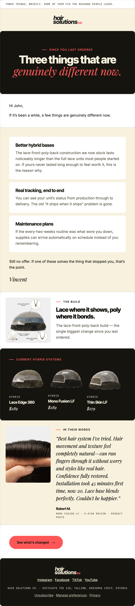

<!-- Generated by .claude/skills/shopify-email-html/scripts/build_library.py — edit section.json / template.json instead. -->

# WB-2 · Win-back: what's changed

| | |
|---|---|
| Code | WB-2 |
| Journey | win-back |
| Surface | Messaging · Code your own |
| Where in Shopify | Not installed yet. Planned: Flow › Win-back › Send marketing email (Messaging, Code your own) |
| Subject | `Three things that are genuinely different now.` |
| Preview text | Briefly: better hybrids, real tracking, and maintenance plans. |
| Timing | WB series starts after 90 days without any order (WB-1). WB-2's delay after WB-1 is not defined. |
| Shopify status | not-installed |
| Shopify matches this repo | **no — re-sync Shopify from the file below** |

## Sections (assembly order)

1. [Email head (fonts + styles)](../../email-blocks/00-email-head-fonts-styles/) — `00-email-head-fonts-styles`
2. [WB-2 · Preheader bar](../../email-blocks/wb-2-preheader-bar/) — `wb-2-preheader-bar`
3. [Logo header](../../email-blocks/02-logo-header/) — `02-logo-header`
4. [WB-2 · Hero](../../email-blocks/wb-2-hero/) — `wb-2-hero`
5. [WB-2 · Intro](../../email-blocks/wb-2-intro/) — `wb-2-intro`
6. [WB-2 · Three changes](../../email-blocks/wb-2-three-changes/) — `wb-2-three-changes`
7. [WB-2 · The build](../../email-blocks/wb-2-build/) — `wb-2-build`
8. [WB-2 · Current hybrid systems](../../email-blocks/wb-2-hybrids/) — `wb-2-hybrids`
9. [WB-2 · Testimonial (Robert M.)](../../email-blocks/wb-2-testimonial/) — `wb-2-testimonial`
10. [WB-2 · CTA](../../email-blocks/wb-2-cta/) — `wb-2-cta`
11. [v6 · Footer (ink, social links)](../../email-blocks/v6-footer-ink-social/) — `v6-footer-ink-social`

## Code to install

- [`template.html`](template.html)

## Open blockers

- 'See what's changed' button points to the homepage for now (see the button-links issue).
- Testimonial is a real review (Robert M., Mono Fusion LF) but not from a returning customer, as the design asks; photo is a product hairline shot.
- Hybrid prices are live Liquid (all_products[handle].price); product handles are hard-coded for Lace Edge 360, Mono Fusion LF and Thin Skin LF.
- Build diagram and product images are crops of the Figma capture; originals are not available.
- 'Maintenance plans' claims supplies arrive automatically on schedule: confirm that offer exists before sending.
- Design's 'View in browser' link is omitted: Shopify Messaging has no variable for it.
- Series trigger confirmed (90 days without any order). WB-1 (first in the series) is not built yet: only an older frame exists.

## Preview

## Rebuild

Edit `template.json` (`sections` is the recipe) or a section, then run `python3 .claude/skills/shopify-email-html/scripts/build_library.py` from the repo root.
